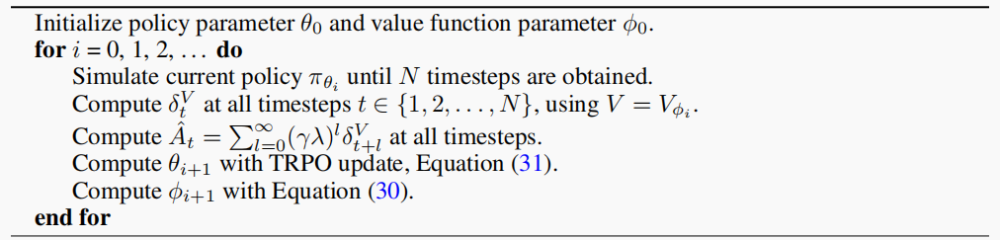
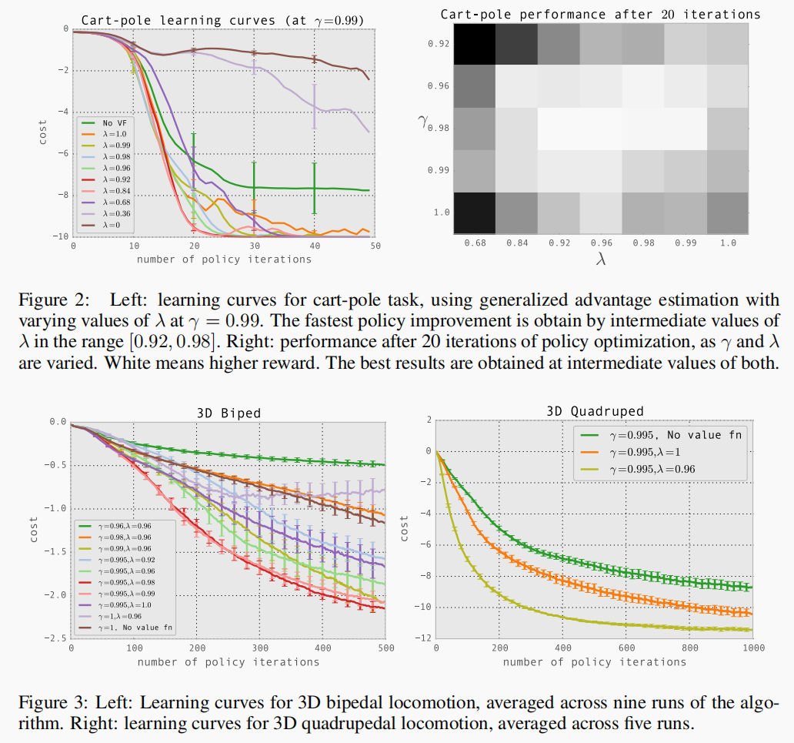
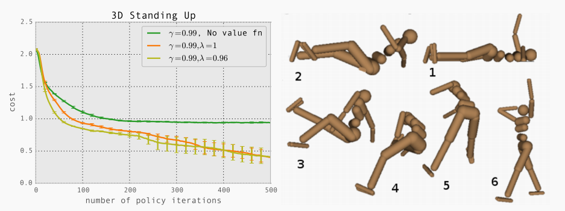

## High-Dimensional Continuous Control Using Generalised Advantage Estimation

## Ước lượng lợi thế tổng quát (GAE): lời giải cho bài toán điều khiển trong không gian liên tục nhiều chiều

> **John Schulman, Philipp Moritz, Sergey Levine, Michael I. Jordan and Pieter Abbeel**
>
> Department of Electrical Engineering and Computer Science
>
> University of California, Berkeley
>
> {joschu,pcmoritz,levine,jordan,pabbeel}@eecs.berkeley.edu
>
> http://arxiv.org/abs/1506.02438

### 1 Dẫn nhập và tổng quan / Introduction

* Hai vấn đề lớn mà học tăng cường cần giải quyết là **bài toán phân bổ phần thưởng (credit assignment problem)** và **bài toán phần thưởng xa (distal reward problem)**, ta thường dùng hàm giá trị để giải quyết khéo léo vấn đề thứ nhất (trong DRL thì giao thẳng việc này cho mạng nơ-ron)
* Khi dùng **thuật toán tăng gradient ngẫu nhiên (stochastic gradient ascent)** ta có thể có được ước lượng không chệch (unbiased estimation) của ma trận gradient, nhưng đặc tính phương sai cao của nó khiến ta không chịu nổi khi xét theo thời gian (vì các ước lượng nhiễu lớn như vậy trộn lẫn với các ước lượng khác theo thời gian, kết quả sẽ thế nào ta cũng không biết được)
* So với lợi tức thực nghiệm (Empirical Return), **thuật toán diễn viên-nhà phê bình (Actor-Critic)** dùng mạng nơ-ron để ước lượng hàm giá trị với cái giá là độ chệch (bias)
* Tác giả cho rằng, lượng dữ liệu lớn sẽ dẫn đến mô hình quá khớp (phương sai cao), nhưng nghiêm trọng hơn là độ chệch gây ra không thể giải quyết bằng lượng dữ liệu, điều này có thể khiến mô hình phân kỳ hoặc hội tụ về cực tiểu cục bộ
* **Tác giả đưa ra một họ hàm ước lượng gradient chính sách $`\text{GAE}(\gamma, \lambda),~ \gamma, \lambda \in [0,1]`$, giảm mạnh phương sai trong khi chỉ đưa vào độ chệch chấp nhận được**
* **Tác giả dùng GAE để huấn luyện trong các môi trường điều khiển 3D độ khó cao**

### 2 Chuẩn bị / Preliminaries

#### 2.1 Ước lượng gradient chính sách

Cho trạng thái ban đầu $`s_0`$ lấy mẫu từ một phân phối $`\rho_0`$, sinh ra một quỹ đạo (trajectory) theo chính sách $`\pi(a|s)`$ và hàm phân phối chuyển trạng thái $`P(s'|s, a)`$. Tại mỗi bước thời gian (time step), tác tử nhận được một phần thưởng $`r_t = r(s_t, a_t, s_{t+1})`$. Vì ta cần tối đa hóa lợi tức kỳ vọng, nên ta lấy gradient của lợi tức kỳ vọng $`\mathbb E\left[\displaystyle \sum_{t=0}^\infty r_t \right]`$:
```math
g := \nabla_\theta \mathbb E\left[ \sum_{t=0}^\infty r_t  \right] = \mathbb  E\left[ \sum_{t = 0}^\infty \Psi_t\nabla_\theta \log \pi_\theta(a_t|s_t) \right]
```

> Về quá trình suy luận chi tiết của đẳng thức trên, ở đây đưa ra một phiên bản không chặt chẽ nhưng dễ hiểu, lấy ví dụ đạo hàm riêng của hàm giá trị theo tham số:
> ```math
> \begin{align}
> \frac{\partial V(s;\boldsymbol \theta)}{\partial \boldsymbol \theta} &=
> \frac{\partial \sum_a \pi(a|s; \boldsymbol \theta)\cdot Q_\pi(s, a)}{\partial \boldsymbol \theta}
> \\
> &= \sum_a\frac{\partial \pi(a|s; \boldsymbol \theta)\cdot Q_\pi(s, a)}{\partial \boldsymbol \theta}
> \\
> &= \sum_a\frac{\partial \pi(a|s; \boldsymbol \theta)}{\partial \boldsymbol \theta}\cdot Q_\pi(s, a) & \text{assume } Q_\pi \text{is independent of }\boldsymbol \theta
> \\
> &= \sum_a\pi(a|s; \boldsymbol \theta) \cdot \frac{\partial \log \pi(a|s; \boldsymbol \theta)}{\partial \boldsymbol \theta}\cdot Q_\pi(s, a) &\text{chain rule}
> \\
> &= \mathbb E_A\left[\frac{\partial \log \pi(A|s; \boldsymbol \theta)}{\partial \boldsymbol \theta}\cdot Q_\pi(s, A)\right]
> \end{align}
> ```
> Remark. Chứng minh tham khảo từ [Shusen Wang, Deep Reinforcement Learning](https://www.bilibili.com/video/BV1rv41167yx/?is_story_h5=false&p=1&share_from=ugc&share_medium=android&share_plat=android&share_session_id=9b64fa10-a83a-4a62-8104-4b8bb316ebdb&share_source=WEIXIN&share_tag=s_i&timestamp=1667564212&unique_k=TKDw0q7&vd_source=81247b204d5fa64ef8de53fe75ccd121)

$`\Psi_t`$ trong công thức có thể được thay bằng các biểu thức sau:

* $`\displaystyle \sum_{t=0}^\infty r_t`$: tổng phần thưởng
* $`\displaystyle \sum_{t'=t}^\infty r_{t'}`$: tổng phần thưởng sau một thời điểm
* $`\displaystyle \sum_{t'=t}^\infty r_{t'} - b(s_t)`$: tổng phần thưởng sau một thời điểm đã trừ đường cơ sở (baseline)
* $`Q^\pi(s_t, a_t)`$: hàm Q
* $`\displaystyle A^\pi (s_t, a_t) := Q^\pi(s_t, a_t) - V^\pi(s_t)`$: **hàm lợi thế (advantage function)**
* $`r_t + V^\pi(s_{t+1})- V^\pi(s_t)`$: phần dư TD (temporal difference residual)


#### 2.2 Hàm lợi thế

Quan sát kỹ các biểu thức trên, ta sẽ thấy hàm lợi thế rất giống mục thứ ba: nếu ta thay đường cơ sở bằng hàm giá trị, thì nó chỉ chênh với hàm lợi thế một hằng số. Tác giả nhắc trong bài rằng trong nhiều lựa chọn như trên, hàm lợi thế đưa vào phương sai thấp nhất. Kết hợp với công thức tính gradient thì điều này không khó hiểu. Ta quy ước trước $`V^\pi`$ là **kỳ vọng** của lợi tức tương lai khi tác tử ở một trạng thái, như vậy hàm lợi thế có thể được phân tách tốt thành hai phần có ý nghĩa rõ ràng:
```math
\displaystyle A^\pi (s_t, a_t) := \underbrace{Q^\pi(s_t, a_t)}_{\text{lợi tức kỳ vọng sau khi thực hiện hành động } a_t \text{ tại thời điểm } t} - \underbrace{V^\pi(s_t)}_{\text{lợi tức kỳ vọng khi tác tử chưa hành động}}
```
Ta lại chú ý rằng trong gradient, $`A^\pi`$ và $`\nabla_\theta \log \pi_\theta`$ có quan hệ nhân, nên trong quá trình huấn luyện ta có thể tăng xác suất hành động "tốt hơn" được chọn, vì hàm lợi thế tương ứng với giá trị hàm $`Q`$ thấp hơn trung bình là âm, điều này khiến tham số đi theo hướng ngược với gradient; tương tự hành động tốt hơn sẽ khiến tham số đi theo hướng gradient, từ đó có thể suy ra kết luận ở trên.


#### 2.3 Ước lượng lợi thế không chệch

Trên cơ sở này ta tiến thêm một bước: đưa vào tham số $`\gamma`$:
```math
\begin{align}
V^{\pi,\gamma}(s_t) & = \mathbb E_{s_{t+1}:\infty,a_{t}:\infty}
\left[ \sum_{l = 0}^\infty \gamma^lr_{t + l} \right]
\\
Q^{\pi,\gamma}(s_t, a_t) & = \mathbb E_{s_{t+1}:\infty,a_{t+1}:\infty}
\left[  \sum_{l = 0}^\infty \gamma^lr_{t + l}  \right]
\\
A^{\pi, \gamma}(s_t, a_t) & = Q^{\pi,\gamma}(s_t, a_t) - V^{\pi,\gamma}(s_t)
\end{align}
```

> Remark. Ý nghĩa chỉ số dưới của ký hiệu kỳ vọng là khoảng lấy kỳ vọng. Ví dụ, khoảng của hàm giá trị là từ hành động lần này và trạng thái lần sau cho đến khi kết thúc, còn hàm Q thì đã biết hành động lần này, nên chỉ số dưới của nó bắt đầu từ $`a_{t+1}`$

Như vậy ta có được một ước lượng của gradient chính sách $`g`$:
```math
g^\gamma
:= \mathbb  E_{s_{0}:\infty,a_{0}:\infty} \left[ \sum_{t = 0}^\infty A^{\pi, \gamma}(s_t, a_t) \nabla_\theta \log \pi_\theta(a_t|s_t) \right]
```
Trước khi nói tiếp, ta giới thiệu một khái niệm và đưa vào một số mệnh đề không chứng minh (nếu quan tâm đến chứng minh có thể xem [bài báo gốc](http://arxiv.org/abs/1506.02438))


**Định nghĩa 1 $`\gamma`$-không chệch ($`\gamma`$-just)**	Nếu một xấp xỉ $`\hat A`$ của $`A^{\pi,\gamma}`$ thỏa mãn với mọi $`t`$ đều có
```math
\mathbb E_{s_{0}:\infty,a_{0}:\infty}
\left[
\sum_{t = 0}^\infty \hat A_t(s_{0:\infty}, a_{0:\infty})
\nabla_\theta \log \pi_\theta(a_t|s_t)
\right]
=
\mathbb E_{s_{0}:\infty,a_{0}:\infty} \left[ \sum_{t = 0}^\infty A^{\pi, \gamma}(s_t, a_t) \nabla_\theta \log \pi_\theta(a_t|s_t) \right]
```
ta gọi $`\hat A`$ là $`\gamma`$-không chệch. Hiển nhiên thay $`\hat A`$ thỏa điều kiện vào công thức trên, giá trị của nó luôn bằng $`g^\gamma`$.


**Mệnh đề 1**	Nếu bất kể ta lấy $`(s_t,a_t)`$ như thế nào, $`\hat A`$ luôn có thể viết thành $`\hat A_t(s_{0:\infty}, a_{0:\infty}) = Q_t(s_{t:\infty}, a_{t:\infty}) - b_t(s_{0:t}, a_{0:t-1})`$, và $`\mathbb E_{s_{t+1}:\infty, a_{t+1}:\infty|s_t, a_t}[Q_t(s_{t:\infty}, a_{t:\infty})] = Q^{\pi,\gamma}(s_t, a_t)`$, thì $`\hat A`$ là $`\gamma`$-không chệch.


Có thể kiểm chứng, các biểu thức dưới đây đều là $`\gamma`$-không chệch:

* $`\displaystyle \sum_{l=0}^\infty \gamma^l r_{t + l}`$: ước lượng không chệch của hàm giá trị
* $`Q^{\pi, \gamma}(s_t, a_t)`$: cho số hạng thứ hai bằng 0
* $`A^{\pi,\gamma}(s_t, a_t)`$: cho số hạng thứ hai là hàm giá trị
* $`r_t + \gamma V^{\pi, \gamma}(s_{t + 1}) - V^{\pi, \gamma}(s_t)`$: giống mục trước


### 3 Ước lượng hàm lợi thế / Advantage Function Estimation

Thực tế ta không thể tính kỳ vọng cho các số hạng trong gradient, trong thực tế ta thường chọn cách lấy trung bình mẫu để ước lượng gradient chính sách:
```math
\hat g = \frac 1N \sum_{n = 1}^N \sum_{t = 0}^\infty \hat A_t^n \nabla_\theta \log \pi_\theta(a_t^n|s_t^n)
```
Chú ý rằng $`\mathbb E_{s_{t+1}}[\delta_t^{V^{\pi, \gamma}}] = A^{\pi, \gamma}(s_t, a_t)`$, ta xây dựng tổng như sau:
```math
\hat A_t^{(k)} := \sum_{l=0}^{k - 1} \gamma^l \delta_{t + l}^V = -V(s_t) + \sum_{l = 0}^{k - 1} \gamma^l r_{t + l} + \gamma^k V(s_{t + k})
```
Trên cơ sở này ta có thể định nghĩa **ước lượng lợi thế tổng quát (generalised advantage estimation)**
```math
\begin{align}
\hat A^{\text{GAE}(\gamma, \lambda)}_t :=& (1 - \lambda)\left( \hat A^{(1)}_1 + \lambda\hat A^{(2)}_1 + \lambda^2\hat A^{(3)}_1 + \cdots \right)\\
=& (1 - \lambda) (\delta^V_t + \lambda(\delta^V_t + \gamma\delta^V_{t + 1}) + \lambda^2(\delta^V_t + \gamma\delta^V_{t + 1}+ \gamma ^ 2\delta_{t + 2}^V) + \cdots)\\
=& (1 - \lambda)(\delta_t^V(1 + \lambda + \lambda^2 +\cdots) + \delta_{t+1}^V(\lambda + \lambda^2 + \lambda^3+\cdots) +\cdots)\\
=& \sum_{l=0}^\infty (\gamma\lambda)^l \delta_{t + l}^V
\end{align}
```

> Ghi chú của người dịch: ở dòng đầu của công thức trên, chỉ số dưới đúng ra là $`t`$ ($`\hat A^{(1)}_t + \lambda\hat A^{(2)}_t + \cdots`$) chứ không phải $`1`$; ở dòng thứ ba, hệ số của $`\delta_{t+1}^V`$ đúng ra là $`\gamma(\lambda + \lambda^2 + \cdots)`$. Kết quả cuối cùng $`\sum_{l}(\gamma\lambda)^l \delta_{t+l}^V`$ vẫn đúng. Bản dịch giữ nguyên công thức của bản gốc.

Ta xét hai trường hợp cực đoan của GAE:
```math
\begin{align}
\hat A^{\text{GAE}(\gamma, 0)}_t &=  \delta_t &= r_t + V(s_{t+1})- V(s_t) \\
\hat A^{\text{GAE}(\gamma, 1)}_t &= \sum_{l=0}^{\infty} \gamma^l \delta_{t + l}^V &=-V(s_t) + \sum_{l = 0}^{\infty} \gamma^l r_{t + l}~\,
\end{align}
```
Nếu $`\lambda = 0`$, nếu ta bỏ qua sai số ước lượng của $`V`$, thì tuy nó là $`\gamma`$-không chệch, nhưng đưa vào phương sai cao; khi $`\lambda = 1`$ phương sai nhỏ hơn so với trường hợp trước, nhưng khi và chỉ khi $`V =V^{\pi, \gamma}`$ thì mới $`\gamma`$-không chệch, nếu không sẽ đưa vào độ chệch. Mục đích của GAE mà tác giả đề xuất là tìm một điểm cân bằng giữa hai cực đoan (makes a compromise).

> Ghi chú của người dịch:
> - Trong dòng đầu của công thức trên, $`\delta_t`$ đúng ra là $`r_t + \gamma V(s_{t+1}) - V(s_t)`$ (thiếu $`\gamma`$).
> - Đoạn văn ngay trên đã nói ngược so với bài báo gốc. Theo bài báo: với $`\lambda = 0`$, $`\hat A_t = \delta_t`$ chỉ $`\gamma`$-không chệch khi $`V = V^{\pi,\gamma}`$, nếu không sẽ có độ chệch, nhưng phương sai thấp; với $`\lambda = 1`$, $`\hat A_t`$ luôn $`\gamma`$-không chệch bất kể độ chính xác của $`V`$, nhưng phương sai cao (vì là tổng các số hạng). Bản dịch giữ nguyên lời văn của bản gốc để đối chiếu, người đọc nên hiểu theo bài báo.

Quan sát lại suy luận ở trên, ta dễ dàng nhận thấy

1. $`\gamma`$ chủ yếu quyết định độ lớn (scale) của hàm giá trị $`V`$, nếu $`\gamma < 1`$ thì đưa vào độ chệch (điều này không khó hiểu)
2. Khi $`\lambda < 1`$ và $`V`$ ước lượng không chính xác sẽ đưa vào độ chệch

Tác giả nghiên cứu phát hiện, **giá trị tốt nhất của $`\lambda`$ nhỏ hơn nhiều so với giá trị tốt nhất của $`\gamma`$, họ cho rằng điều này là do độ chệch mà $`\lambda`$ đưa vào khi $`V`$ không chính xác nhỏ hơn nhiều so với $`\gamma`$.** Dựa trên phân tích ở trên ta có thể dùng GAE để ước lượng gradient chính sách tốt hơn:
```math
g^\gamma \approx \mathbb E \left[
\sum_{t = 0}^\infty \nabla_\theta \log \pi_\theta(a_t|s_t) \hat A_t^{\text{GAE}(\gamma, \lambda)}
\right] =
\mathbb E \left[
\sum_{t = 0}^\infty \nabla_\theta \log \pi_\theta(a_t|s_t) \sum_{l=0}^\infty (\gamma\lambda)^l \delta_{t + l}^V
\right]
```
Trong đó dấu xấp xỉ đầu tiên trở thành dấu bằng khi và chỉ khi $`\lambda = 1`$


### 4 Giải thích GAE thông qua thiết kế hàm phần thưởng / Interpretations as Reward Shaping


**Định nghĩa 2 Hàm phần thưởng biến đổi**	Cho một hàm vô hướng bất kỳ $`\Phi: \mathcal S \rightarrow \mathbb R`$ từ không gian trạng thái $`\mathcal S`$ đến $`\mathbb R`$, và hàm phần thưởng $`r(s, a ,s')`$, định nghĩa hàm phần thưởng sau biến đổi $`\tilde r`$:
```math
\tilde r(s, a, s') := r(s, a, s') + \gamma \Phi(s') - \Phi(s)
```
Xét tổng chuỗi hàm phần thưởng biến đổi có suy giảm theo hàm mũ, ta thấy nó chỉ chênh với tổng chuỗi hàm phần thưởng một $`\Phi`$
```math
\sum_{l = 0}^\infty \gamma^l \tilde r(s_{t+l}, a_t, s_{t + l + 1})
 =
 \sum_{l = 0}^\infty \gamma^l r(s_{t+l}, a_t, s_{t + l + 1}) - \Phi(s_t)
```
Ta có thể phỏng theo định nghĩa hàm phần thưởng biến đổi để định nghĩa $`V`$, $`Q`$ và hàm lợi thế $`A`$ sau biến đổi:

* $`\tilde Q^{\pi, \gamma}(s, a) = Q^{\pi, \gamma}(s, a) - \Phi(s)`$
* $`\tilde V^{\pi, \gamma}(s) = V^{\pi, \gamma}(s) - \Phi(s)`$ *(trong bài báo là $`V(s, a)`$, người viết cho rằng phải là $`V(s)`$, **<u>lý do là:</u>**)
* $`\tilde A^{\pi, \gamma}(s, a) = (Q^{\pi, \gamma}(s, a) - \Phi(s)) - (V^{\pi, \gamma}(s) - \Phi(s)) = A^{\pi, \gamma}(s, a)`$

> Tác giả đưa ra ba hàm này theo trình tự logic:
>
> 1. Thông qua tổng chuỗi có suy giảm theo hàm mũ có thể trực tiếp suy ra $`\tilde Q`$
>
> 2. Sau khi đã suy ra $`\tilde Q`$, dựa vào quan hệ giữa $`Q`$ và $`V`$
> ```math
> V(s) = \sum_{a \in \mathscr A} \pi(a|s)Q(s, a)
> ```
>    Nếu định nghĩa $`\tilde V`$ là kết quả có được khi thay $`\tilde Q`$ vào vế phải công thức trên, có thể biến đổi như sau
> ```math
> \tilde V(s) = \sum_{a \in \mathscr A} \pi(a|s)\tilde Q(s, a) =\sum_{a \in \mathscr A} \pi(a|s)[Q(s, a) - \Phi(s)]' = V(s) - \Phi(s)
> ```
>
> 3. Đã biết $`\tilde V`$ và $`\tilde Q`$ thì có thể tự nhiên suy ra $`\tilde A`$
>
> Remark. Bài báo của Andrew Ng (吴恩达) và cộng sự ([Ng et al, 1999](http://luthuli.cs.uiuc.edu/~daf/courses/games/AIpapers/ml99-shaping.pdf)) chỉ ra rằng phép biến đổi như vậy không ảnh hưởng đến chính sách tối ưu (optimal policy) cuối cùng

> Ghi chú của người dịch: ở mục $`\tilde V`$ phía trên, bản gốc để câu "lý do là:" dở dang; phần trích dẫn ngay sau đó (ba bước suy luận) chính là lời giải thích.

Nếu $`\Phi`$ vừa đúng bằng $`V^{\pi,\gamma}`$, thì $`\tilde V^{\pi,\gamma} \equiv 0`$

Nếu cho $`\Phi = V`$ ta có được GAE:
```math
\sum_{l=0}^\infty (\gamma \lambda)^l \tilde r(s_{t + l}, a_t, s_{t + l + 1}) = \sum_{l= 0}^\infty (\gamma \lambda)^l \delta_{t + l}^V = \hat A_t^{\text{GAE}(\gamma, \lambda)}
```

---

Để hiểu sâu hơn về các tham số $`\gamma`$ và $`\lambda`$ trong phép biến đổi, ta đưa vào định nghĩa sau:


**Định nghĩa 3 Hàm phản hồi**	
```math
\chi (l;s_t, a_t) := \mathbb E[r_{t + l}|s_t, a_t] - \mathbb E[r_{t + l}|s_t]
```


Có thể thấy điều này rất giống hàm lợi thế ta định nghĩa trước đó. Thực tế, ta dễ dàng kiểm chứng
```math
A^{\pi, \gamma}(s, a) = \sum_{l  =0}^\infty \gamma^l \chi(l; s, a)
```
Qua công thức trên ta có được: hàm phản hồi có thể phân tách hàm lợi thế theo thời gian, đồng thời cũng cho phép ta định lượng bài toán phân bổ phần thưởng: quan hệ giữa hành động và phần thưởng tương ứng trong thời gian dài tương ứng với việc hàm phản hồi có bằng 0 hay không khi $`l`$ lớn hơn nhiều so với $`0`$

Ta thay biểu diễn trên vào số hạng trong hàm kỳ vọng của gradient chính sách:
```math
\nabla_\theta \log \pi_\theta(a_t|s_t) \cdot A^{\pi, \gamma}(s_t, a_t)  =
\nabla_\theta \log \pi_\theta(a_t|s_t) \sum_{l=0}^\infty \gamma^l \chi(l;s_t, a_t)
```
Nếu $`\gamma < 1`$, ta bỏ tất cả các số hạng $`\displaystyle l \gg \frac 1{1 - \gamma}`$, sai số ước lượng của công thức trên giảm nhanh khi $`l`$ tăng. Tức là những lợi ích tương lai quá xa hiện tại không thể được mô hình dự kiến ("forgotten")

Nếu $`\Phi = V^{\pi, \gamma}`$ trong $`\tilde r`$, thì khi $`l \ne0`$, hàm phản hồi luôn bằng 0, tương ứng với trường hợp mô hình chỉ quan tâm đến lợi tức nhận được ngay lập tức. Tất nhiên ta muốn tìm được một $`V \approx V^{\pi,\gamma}`$ để thông tin theo thời gian có thể được truyền đi. Như vậy ta lại quay về định nghĩa của $`\hat A_t^{\text{GAE}(\gamma, \lambda)}`$.

> Ta có thể xem $`\lambda^l \delta_{t + l}^V`$ là TD residual (phần dư TD) sau khi co giãn, để đưa vào độ chệch, khiến $`V \ne V^{\pi,\gamma}`$

Từ góc độ hàm phản hồi, ta lại có thể hiểu là lấy một tham số nhỏ hơn $`(\gamma \lambda)`$, và khiến mô hình không thể dự kiến các trường hợp $`\displaystyle l \gg \frac 1{1 - \gamma\lambda}`$


### 5 Xấp xỉ hàm giá trị / Value Function Estimation


Tác giả dùng phương pháp Monte Carlo để hàm giá trị có tham số phi tuyến tiến gần đến giá trị thực, và dùng thuật toán vùng tin cậy để giới hạn bước cập nhật:
```math
\begin{align}
\mathop{\text{minimize}}\limits_{\phi} ~~& \sum_{n = 1}^N \| V_\phi(s_n) - \hat V_n \|^2\\
\text{s.t.}~~& \frac 1N \sum_{n = 1}^N \frac{\| V_\phi(s_n) - V_{\phi_{old}}(s_n) \|^2}{2\sigma ^2} \le \varepsilon
\end{align}
```
Trong đó $`\displaystyle \frac 1N\sum_{n = 1}^N \| V_{\phi_{old}}(s_n) - \hat V_n \|^2`$

> Ghi chú của người dịch: câu trên trong bản gốc bị dở dang; theo bài báo, $`\sigma^2 = \frac 1N\sum_{n = 1}^N \| V_{\phi_{old}}(s_n) - \hat V_n \|^2`$.

Tác giả không dùng trực tiếp phương pháp trên, mà dùng thuật toán gradient liên hợp để xấp xỉ bài toán trên, biến thành bài toán quy hoạch bậc hai như sau
```math
\begin{align}
\mathop{\text{minimize}}\limits_{\phi} ~~& g^T (\phi - \phi_{old}) \\
\text{s.t.}~~& \frac 1N \sum_{n = 1}^N (\phi - \phi_{old})^TH(\phi - \phi_{old}) \le \varepsilon
\end{align}
```
Trong đó $`H`$ là xấp xỉ Gauss-Newton của ma trận Hessian của mục tiêu tối ưu: 
```math
\displaystyle H= \frac 1N\sum_n j_nj_n^T = \frac 1N \sum_n \nabla_\phi V_\phi(s_n) (\nabla_\phi V_\phi(s_n))^T
```


### 6 Thuật toán và thực hành / Experiments


**Tối ưu chính sách**

Tác giả dùng TRPO để giải bài toán tối ưu có ràng buộc sau:
```math
\begin{align}
\mathop{\text{minimize}}\limits_{\phi} ~~& g^T (\phi - \phi_{old}) \\
\text{s.t.}~~&
\frac 1N \overline{D}_{KL}^{\theta_{old}}(\pi_{old}, \pi_{\theta}) \le \varepsilon\\
\text{where}~~&
L_{\theta_{old}}(\theta) = \frac 1N \sum_{n = 0}^N \frac{\pi_{\theta}(a_n|s_n)}{\pi_{\theta_{old}}(a_n|s_n)}\hat A_n\\
& \overline{D}_{KL}^{\theta_{old}}(\pi_{old}, \pi_{\theta}) =
\frac 1N \sum_{n = 1}^N D_{KL}[\pi_{\theta_{old}}(\cdot | s_n) \| \pi_\theta(\cdot | s_n)]

\end{align}
```
Tương tự, tác giả cũng xử lý thêm bằng cách tuyến tính hóa mục tiêu tối ưu và biến điều kiện ràng buộc thành dạng bậc hai.


**Thuật toán**




**Thực hành**

Tác giả dùng cùng một cấu trúc mạng nơ-ron để huấn luyện trên các nhiệm vụ con lắc ngược, chuyển động hai chân, chuyển động bốn chân, đứng dậy. Kết quả như sau:






> Ghi chú của người dịch: bản gốc viết "bốn nhiệm vụ ... này ba nhiệm vụ 3D" (倒立摆、双足运动、四组运动、站立这三个3D任务). Trong bài báo, con lắc ngược (cart-pole) là nhiệm vụ cổ điển, còn ba nhiệm vụ 3D là chuyển động hai chân (biped), chuyển động bốn chân (quadruped) và đứng dậy (stand up).


### 7 Thảo luận / Discussion

* Thuật toán gradient chính sách tuy có thể đơn giản hóa nhiệm vụ học tăng cường thành nhiệm vụ giảm gradient ngẫu nhiên không chệch, nhưng cho đến nay (thời điểm bài báo) khả năng giải các bài toán điều khiển khá khó của nó bị hạn chế do độ phức tạp lấy mẫu khá cao
* Tác giả đề xuất phương pháp dùng hai tham số để cân bằng phương sai và độ chệch của mô hình, và dùng thuật toán vùng tin cậy giúp mô hình đạt hiệu quả khá tốt trong các bài toán điều khiển khá khó
* Thực nghiệm phát hiện, hiệu quả tốt nhất khi $`\lambda \in [0.9, 0.99]`$, nhưng vẫn mong tương lai có phương pháp tự động điều chỉnh giá trị $`\lambda`$
* Hiện tại quan hệ giữa sai số gradient chính sách và sai số ước lượng hàm giá trị vẫn chưa rõ, nếu ta biết quan hệ giữa chúng, thì có thể chọn thước đo sai số ước lượng hàm giá trị phù hợp theo hàm sai số gradient chính sách
* Một phương pháp khả thi khác là xấp xỉ chính sách và hàm giá trị bằng cùng một cấu trúc, và dùng GAE để tối ưu cái trước. Nhưng làm thế nào để chuyển nó thành bài toán tối ưu số và tính hội tụ của phương pháp này vẫn còn cần kiểm chứng. Nếu phương án này khả thi thì sẽ giúp xấp xỉ chính sách và hàm giá trị có thể dùng chung các đặc trưng học được, để tăng tốc huấn luyện
* Tác giả tuy phát hiện lợi tức bậc một ($`\lambda = 0`$) dẫn đến độ chệch quá lớn khiến mô hình thể hiện kém, nhưng có nghiên cứu cho thấy nếu điều chỉnh phù hợp, mô hình cũng có thể chạy bình thường, chỉ là các nghiên cứu này giới hạn trong không gian trạng thái và hành động có số chiều khá thấp. So sánh hai loại phương pháp này trong cùng điều kiện sẽ rất hữu ích cho nghiên cứu trong tương lai


### 8 Suy ngẫm / Reflection

* Tác giả đã giải thích hợp lý vai trò của $`\lambda`$ và $`\gamma`$, nhưng nếu xem tích của chúng là một khối, thì có vẻ như không khác gì $`\gamma`$?
  * Giải thích thêm?
