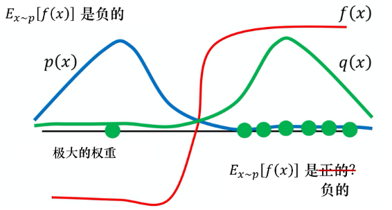
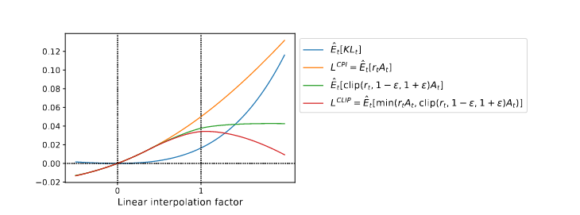
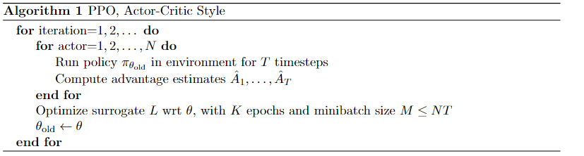
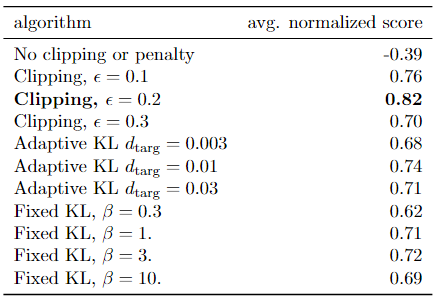
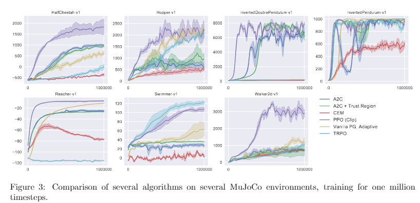

## Phân tích bài báo Proximal Policy Optimization Algorithms

John Schulman, Filip Wolski, Prafulla Dhariwal, Alec Radford, Oleg Klimov from OpenAI

### 0. Thông tin bài báo

Proximal Policy Optimization Algorithms

John Schulman, Filip Wolski, Prafulla Dhariwal, Alec Radford, Oleg Klimov from OpenAI, 2017

https://arxiv.org/abs/1707.06347

### 1. Động cơ viết bài

Những năm gần đây, người ta đề xuất một số phương pháp khác nhau dùng xấp xỉ hàm bằng mạng nơ-ron để học tăng cường. Đối thủ chính là phương pháp dựa trên giá trị DQN, tiếp theo là phương pháp dựa trên chính sách "Vanilla Policy Gradient" (tức phương pháp gradient chính sách cơ bản nhất, viết tắt VPG. *Vanilla là một từ thú vị, nghĩa gốc là vani, vì đó là vị kem cơ bản nhất, nên thường dùng để chỉ ý "cơ bản nhất", học thêm được một điều*), cuối cùng là phương pháp vùng tin cậy/gradient chính sách tự nhiên (TRPO). Tuy nhiên ba phương pháp này có nhược điểm nghiêm trọng:

1. Deep Q-Learning thể hiện không tốt khi giải một số bài toán **không gian hành động liên tục**
2. Thuật toán VPG cần lấy mẫu một lô mẫu theo hàm chính sách hiện tại trước, sau khi dùng mẫu để cập nhật, lô mẫu đó mất hiệu lực, cần lấy mẫu lại, nên hiệu quả lấy mẫu thấp
3. TRPO thiết kế phức tạp, không tương thích với các cấu trúc như chia sẻ tham số, dropout

Động cơ viết bài báo này là dùng một phương pháp tối ưu bậc một mà có được hiệu năng tốt (hiệu quả lấy mẫu dữ liệu, tính bền vững) của TRPO phức tạp.

### 2. Giới thiệu ngắn gọn kiến thức nền

#### 1. Thuật toán gradient chính sách

Thuật toán gradient chính sách tham số hóa chính sách $`\pi`$ thành $`\pi _\theta`$, rồi tối ưu tham số bằng phương pháp tăng gradient, gradient chính sách thường dùng nhất có dạng như sau:

```math
\hat{g}=\hat{\mathbb{E}_t}[\nabla _{\theta}\log \pi_\theta(a_t|s_t)\hat{A_t}] \tag{1}
```

Trong đó, $`\hat{A_t}`$ là bộ ước lượng của hàm lợi thế (Advantage Function), $`\mathbb{E}_t`$ là trung bình trên một batch hữu hạn. Có thể ngược lại tìm được Loss-function (hàm mất mát):

```math
L(\theta)=\hat{\mathbb{E}}_t[\pi_\theta(a_t|s_t)\hat{A_t}] \text{ (ở đây có thể khác bài gốc, nhưng vì tính đơn điệu của hàm log, thực chất là như nhau)} \tag{2}
```

Quá trình làm việc là lặp lại lấy mẫu và tối ưu mô hình. Tác giả nói ở đây: ***nghe có vẻ dùng dữ liệu của cùng một lần lấy mẫu để cập nhật tham số chính sách nhiều lần rất hấp dẫn, nhưng thực nghiệm về sau chứng minh ảnh hưởng gây ra là mang tính phá hoại***, lý do ở đây sẽ được nhắc đến ở phần tiếp theo.

#### 2. Lấy mẫu theo trọng số quan trọng

##### (1) Tại sao cần dùng importance sampling?

Trước tiên trả lời câu hỏi nêu ở phần trước: **tại sao dữ liệu của cùng một lần lấy mẫu không thể dùng trực tiếp để cập nhật nhiều lần?**

Quay lại suy luận gradient chính sách. Theo ý tưởng ban đầu nhất, thứ ta muốn tối đa hóa là kỳ vọng phần thưởng tích lũy $`\bar{R_\theta}(\tau)=p_\theta(\tau)R(\tau)`$ của mỗi chuỗi tương tác hoàn chỉnh $`\tau :(s_1,a_1,r_1,s_2,a_2,r_2...,s_n,a_n,r_n)`$, thông qua tính gradient chính sách và dùng phương pháp tối ưu tăng gradient để cập nhật tham số, trong đó gradient chính sách là:

```math
\nabla \bar{R}_\theta=\mathbb{E}_{\tau\sim p_\theta(\tau)}[R(\tau)\nabla \log(p_\theta(\tau))] \tag{3}
```

Viết lại thành gradient chính sách theo cặp hành động-trạng thái, và dùng hàm lợi thế:

```math
\nabla \bar{R}_\theta=\mathbb{E}_{(s_t,a_t)\sim \pi_{\theta}}[\hat{A}_t\nabla \log\pi_{\theta}(a_t|s_t)] \tag{4.1}
```

```math
L(\theta)=\mathbb{E}_{(s_t,a_t)\sim \pi_{\theta}}[\pi_{\theta}(a_t|s_t)\hat{A}_t ]                          \tag{4.2}
```

Suy luận cụ thể có thể tham khảo bài viết Zhihu của tôi [*Ghi chú học tăng cường -6 Phương pháp dựa trên chính sách: thuật toán gradient chính sách (PG) và REINFORCE - bài viết của Yu Tianqi*](https://zhuanlan.zhihu.com/p/549583458		).

Chính vì trong công thức $`(4)`$, định nghĩa của kỳ vọng (chỉ số dưới) yêu cầu **các mẫu $`(s_t, a_t)`$ dùng để cập nhật phải được sinh ra theo chính sách tham số hóa hiện tại $`\pi_\theta`$**, nên mỗi khi ta dùng mẫu lấy theo chính sách này để cập nhật tham số chính sách, chính sách đã thay đổi, vì vậy cần lấy mẫu lại theo chính sách đã thay đổi. Mở rộng từ chuỗi hoàn chỉnh sang cặp trạng thái-hành động cũng tương tự.

Vì vậy muốn dùng lại dữ liệu lấy mẫu trước đó để cập nhật chính sách nhiều lần, cần dùng một phương pháp nhất định để thay đổi phân phối của mẫu cũ, giúp nó cùng phân phối với mẫu sinh ra bởi chính sách mới, phương pháp này chính là importance sampling.

##### (2) Importance sampling là gì

Hiện có các phân phối $`p(x)`$ và $`q(x)`$, lấy mẫu ngẫu nhiên từ $`p(x)`$ để tính kỳ vọng của hàm $`f(x)`$: $`\mathbb{E}_{x \sim p}[f(x)]=\int f(x)p(x)dx`$, nếu nhân nó với **một hệ số quan trọng $`\frac{q(x)}{p(x)}`$**, thì có thể dùng mẫu từ phân phối $`p(x)`$ để tính kỳ vọng của $`f(x)`$ dưới phân phối $`q(x)`$, tức là:

```math
\mathbb{E}_{x \sim p}[\frac{q(x)}{p(x)}f(x)]=\int \frac{q(x)}{p(x)}f(x)p(x)dx=\int f(x)q(x)dx=\mathbb{E}_{x \sim q}[f(x)] \tag{5}
```

Trên đây chính là importance sampling. Nhân hàm cần tính kỳ vọng với một hệ số quan trọng (tỉ số giữa phân phối mục tiêu và phân phối lấy mẫu), là có thể lấy mẫu dữ liệu từ một phân phối để tính kỳ vọng của phân phối khác. Dùng importance sampling, có thể viết lại gradient chính sách ban đầu:

```math
\nabla \bar{R}_\theta=\mathbb{E}_{(s_t,a_t)\sim \pi_{\theta '}}[\frac{\pi_\theta(a_t|s_t)}{\pi_{\theta '}(a_t|s_t)}\hat{A}_t\nabla \log\pi_{\theta}(a_t|s_t)]    \tag{6.1}
```

```math
L(\theta)=\mathbb{E}_{(s_t,a_t)\sim \pi_{\theta '}}[\frac{\pi_\theta(a_t|s_t)}{\pi_{\theta '}(a_t|s_t)}\hat{A}_t ]                          \tag{6.2}
```

##### (3) Tính chất đặc biệt của importance sampling

Sau importance sampling, có thể lấy mẫu từ $`p(x)`$ để tìm kỳ vọng của $`f(x)`$ dưới phân phối $`q(x)`$, như công thức $`(5)`$, vậy có phải giải quyết một lần là xong mãi? Nếu tính phương sai của cả hai sẽ phát hiện:

```math
\mathrm{Var}_{x \sim q}[f(X)]=\mathbb{E}_{x \sim q}[f(x)^2]-[\mathbb{E}_{x \sim q}[f(x)]^2 \tag{7.1}
```

```math
\mathrm{Var}_{x\sim p}[\frac{q(x)}{p(x)}f(x)]=\mathbb{E}_{x \sim p}[(\frac{q(x)}{p(x)}f(x))^2]-[\mathbb{E}_{x \sim p}[\frac{q(x)}{p(x)}f(x)]^2=\mathbb{E}_{x \sim q}[f(x)^2\frac{q(x)}{p(x)}]-(\mathbb{E}_{x \sim q}[f(x)])^2 \tag{7.2 }
```

Phương sai của hai cái không bằng nhau, chênh lệch nằm ở trọng số quan trọng. Nếu trọng số quan trọng quá lớn, sẽ dẫn đến phương sai khá lớn, tiếp đó khiến việc lấy mẫu vẫn thất bại.

> Lấy một ví dụ từ Sách Nấm *Easy RL*:
>
> 
>
> Ở đây đường màu đỏ biểu thị đường cong f(x), các đường xanh lam, xanh lá biểu thị các phân phối khác nhau của x, trong đó tung độ càng cao, càng dễ được lấy trong phân phối đó. Trong phân phối mẫu của p(x), kỳ vọng tính được của f(x) là âm. Thực tế khi dùng importance sampling, lấy mẫu dữ liệu từ q để ước lượng p, có xác suất cực cao lấy mẫu được các x từ phân phối q(x) có f(x) dương, rất ít khi lấy mẫu được x có f(x) âm. Tuy khi tính kỳ vọng ở các điểm âm sẽ nhân với một trọng số quan trọng đặc biệt lớn, giúp kỳ vọng f(x) có được từ importance sampling là đúng, nhưng tiền đề là phải lấy mẫu được các điểm như vậy. Trong lấy mẫu thực tế, rất có thể vì số lần lấy mẫu không đủ mà không lấy mẫu được các điểm như vậy, dẫn đến importance sampling cuối cùng thất bại.

Vì vậy, tiền đề của importance sampling là trọng số quan trọng không được quá lớn, tức là **chênh lệch giữa hai phân phối không được quá lớn**. Ở đây ta dùng độ phân kỳ KL để đánh giá mức độ tương đồng của hai phân phối.

##### (4) Những điều khác muốn nói

Khi phỏng vấn thực tập sinh vị trí thuật toán RL ở công ty Khởi Nguyên (启元), tôi được hỏi một câu: **Tại sao các phương pháp kiểu Q-Learning dùng Replay buffer mà không cần importance sampling?** Lúc đó tôi không trả lời được.

Câu trả lời của thầy Yu Yang (俞扬) phòng thí nghiệm LAMDA Đại học Nam Kinh rất dễ hiểu. [Tại sao DQN không cần off policy correction? - câu trả lời của Yu Yang - Zhihu](https://www.zhihu.com/question/394866647/answer/1264965104) 

> Ghi chú của người dịch: bản gốc viết "Reply buffer", đã sửa thành "Replay buffer".

#### 3. Độ phân kỳ KL

Độ phân kỳ KL, còn gọi là entropy tương đối, là một chỉ số đo dùng để đo mức độ tương đồng của hai phân phối xác suất.

```math
\begin{aligned}
D_{KL}(P||Q) &= H(P,Q)-H(P) \\
&= \sum_i P(x_i)\log \frac{1}{Q(x_i)}-\sum_i P(x_i)\log \frac{1}{P(x_i)} \\
&= \sum_i P(x_i)\log\frac{P(x_i)}{Q(x_i)}
\end{aligned}
```

Độ phân kỳ KL càng nhỏ, hai phân phối càng gần nhau. Để hạn chế chênh lệch giữa phân phối chính sách được cập nhật bằng importance sampling và phân phối chính sách lấy mẫu không quá lớn, tức là hạn chế độ phân kỳ KL $`D_{KL}(\pi_\theta||\pi_{\theta '})`$ của hai chính sách nhỏ. TRPO dùng chính cách này.

**Chú ý: độ phân kỳ KL ở đây trong PPO/TRPO chỉ phân phối của chính sách đầu ra của hai chính sách (mạng). Đo quan hệ giữa tham số của hai mạng là vô nghĩa!!!!**

#### 4. Phương pháp vùng tin cậy

TRPO dùng dữ liệu lấy mẫu bởi chính sách lần trước $`\pi_{\theta_{old}}`$ để cập nhật chính sách hiện tại $`\pi_\theta`$

Thông qua hạn chế độ phân kỳ KL để hạn chế chênh lệch giữa phân phối của hai chính sách

```math
\begin{gathered}
\mathop{\mathrm{maximize}}\limits_\theta\,\,\,{\hat {\mathbb{E}}_t[\frac{\pi_\theta(a_t|s_t)}{\pi_{\theta'}(a_t|s_t)}\hat A_t]}\\ \text{subject to}\;\;\hat{\mathbb{E}}_t[KL[\pi_{\theta_{old}}(\cdot|s_t),\pi_\theta(\cdot|s_t)]]\leq\delta
\end{gathered}\tag{8}
```

Tương đương với bài toán tối ưu không ràng buộc:

```math
\mathop{\mathrm{maximize}}\limits_\theta\,\,\,\hat{\mathbb{E}}_t\left[\frac{\pi_\theta(a_t|s_t)}{\pi_{\theta'}(a_t|s_t)}\hat A_t-\beta\, KL[\pi_{\theta_{old}}(\cdot|s_t),\pi_\theta(\cdot|s_t)]\right] \tag{9}
```

 Thực nghiệm về sau cho thấy, chỉ đơn giản chọn một hệ số phạt cố định β, dùng SGD để tối ưu phương trình mục tiêu phạt $`(9)`$ là không đủ; còn cần thực hiện các sửa đổi khác.


### 3. Tối ưu chính sách cận kề PPO

#### 1. Tối ưu cận kề có cắt (PPO-clip)

Trước tiên định nghĩa $`r_t(\theta)=\frac{\pi_\theta(a_t|s_t)}{\pi_{\theta _{old}}(a_t|s_t)},so\,\,\,r(\theta_{old})=1`$, hàm mất mát chuyển thành:

```math
L(\theta)=\hat{\mathbb{E}}_t[r_t(\theta) \hat A_t] \tag{10}
```

Để phạt các lần cập nhật chính sách quá lớn, thiết kế hàm mất mát mới:

```math
L^{CLIP}(\theta)=\hat{\mathbb{E}}_t[\min(r_t(\theta) \hat A_t,clip(r_t(\theta),1-\epsilon,1+\epsilon)\hat{A}_t] \tag{11}
```

Trong đó hàm clip() nghĩa là khi $`r_t(\theta)\in[1-\epsilon,1+\epsilon]`$, hàm đưa ra $`r_t(\theta)`$; khi vượt cận trên/dưới, thì đưa ra cận trên/dưới.

Ở đây cải tạo hàm mất mát như vậy là để **giới hạn hàm mất mát trong một phạm vi nhất định**, từ đó **giới hạn gradient**, cuối cùng **giới hạn biên độ cập nhật tham số chính sách**, kiểm soát chênh lệch phân phối giữa hai chính sách trước và sau, giúp việc cập nhật bằng mẫu lấy theo chính sách lần trước có hiệu lực.

Phương pháp PPO-clip không dùng độ phân kỳ KL, tác giả vẽ hình so sánh sự thay đổi của các hàm khác theo quá trình cập nhật 

Có thể thấy khi số bước thời gian tăng, độ phân kỳ KL và hàm mất mát đều tăng, còn hàm mất mát sau khi thêm cắt có thể duy trì ở một mức nhất định.

Tác giả phát hiện qua thực nghiệm, khi $`\epsilon=0.2`$ hiệu quả tốt nhất.

#### 2. Hệ số phạt thích nghi (PPO-pen)

Kế thừa ý tưởng của TRPO, dùng độ phân kỳ KL để đo chênh lệch giữa phân phối chính sách cũ và mới. Nhưng ở đây dùng một tham số thích nghi $`\beta`$, quy trình cụ thể của thuật toán là:

- Dùng bộ tối ưu SGD, hàm mất mát

  ```math
  L^{KLPEN}(\theta)=\hat{\mathbb{E}}_t\left[\frac{\pi_\theta(a_t|s_t)}{\pi_{\theta'}(a_t|s_t)}\hat A_t-\beta\, KL[\pi_{\theta_{old}}(\cdot|s_t),\pi_\theta(\cdot|s_t)]\right]\tag{12}
  ```

  > Ghi chú của người dịch: các công thức (8), (9) và (12) ở bản gốc viết $`\pi_{\theta'(a_t|s_t)}`$ (đặt nhầm $`(a_t|s_t)`$ vào chỉ số dưới) và ở (9), (12) thừa một dấu ngoặc vuông; bản dịch đã sửa thành $`\pi_{\theta'}(a_t|s_t)`$ và cân lại dấu ngoặc.

  để tối ưu cập nhật chính sách, và chỉ định trước một độ phân kỳ KL mục tiêu $`d_{targ}`$

- Tính $`d=\hat{\mathbb{E}}_t[KL[\pi_{\theta_{old}}(\cdot|s_t),\pi_\theta(\cdot|s_t)]]`$ để cập nhật giá trị hệ số phạt $`\beta`$:

  - Nếu $`d<d_{targ}/1.5,\beta=\beta/2`$
  - Nếu $`d>d_{targ}×1.5,\beta=\beta×2`$

Ở đây 1.5 và 2 đều là siêu tham số theo kinh nghiệm (heuristic), mục đích là khi độ phân kỳ thay đổi mạnh có thể nhanh chóng điều chỉnh hệ số phạt để duy trì phân phối chính sách. Thực nghiệm cho thấy thuật toán này không nhạy với các siêu tham số nói trên. Hơn nữa có thể tự thích nghi điều chỉnh siêu tham số cố định trong số hạng phạt của TRPO, giúp hiệu năng thuật toán tăng đáng kể.

#### 3. Tổng quan thuật toán PPO

Nhờ dùng importance sampling, PPO có thể dùng lại dữ liệu lấy mẫu lần trước để cập nhật nhiều lần. Thay LossFunction bằng $`L^{CLIP}\,\,or\,\,L^{KLPEN}`$.

Kết hợp các phương pháp phổ biến, thêm "chính quy hóa" trong RL là $`entropy bonus\,\,S[\pi_\theta](s_t)`$ (để tăng khả năng khám phá). Khi tính advantage để giảm phương sai cũng dùng đến hàm giá trị trạng thái $`V_\theta(s_t)`$ (đôi khi chính sách và giá trị dùng chung mạng), nên thêm $`L_{t}^{LF}(\theta)=(V_\theta(s_t)-V_t^{targ})^2`$ để huấn luyện mạng có thể học ước lượng ra hàm giá trị trạng thái khá sát thực tế. Hàm mất mát cuối cùng có dạng sau:

```math
L_t^{CLIP+VF+S}(\theta)=\hat{\mathbb{E}}_t[L_t^{CLIP}(\theta)-c_1L_t^{VF}(\theta)+c_2S[\pi_\theta](s_t)]\tag{13}
```

Thuật toán như sau



### 4. Thực nghiệm

#### 1. So sánh chênh lệch giữa các hàm mất mát khác nhau

Tác giả so sánh: ba hàm mất mát không cắt và không phạt, cắt, phạt (ở đây không dùng cấu trúc chia sẻ hàm giá trị trạng thái và entropy bonus) tức các công thức $`(6),(10),(12)`$, với các siêu tham số khác nhau trên nhiệm vụ OpenAI MuJoCo physics engine, kết quả như sau:



Trên nhiệm vụ này, thuật toán PPO-clip đạt điểm cao nhất, hệ số phạt thích nghi đạt điểm cao hơn một chút so với hệ số phạt cố định.

#### 2. So sánh với các thuật toán điều khiển liên tục khác



PPO-clip về cơ bản vượt các thuật toán trước đó.

#### 3. Dùng thành công thuật toán PPO để huấn luyện Humanoid Running and Steering

#### 4. Kiểm tra và so sánh thuật toán PPO trên các trò chơi Atari khác

### 5. Kết luận

Chúng tôi đưa vào tối ưu chính sách cận kề, đây là một nhóm phương pháp tối ưu chính sách dùng nhiều epoch tăng gradient ngẫu nhiên (lấy mẫu một lần dùng nhiều lần) để thực hiện mỗi lần cập nhật chính sách. Các phương pháp này có tính ổn định và độ tin cậy của TRPO, nhưng cài đặt đơn giản hơn nhiều, chỉ cần thay đổi vài dòng code trong cài đặt gradient chính sách thông thường, áp dụng được cho các thiết lập tổng quát hơn (ví dụ khi dùng kiến trúc chung cho chính sách và hàm giá trị), và có hiệu năng tổng thể tốt hơn.

### 6. Thông tin người viết

Yu Tianqi (于天琪), đang học tại lớp thực nghiệm Trần Canh (陈赓实验班) Đại học Kỹ thuật Cáp Nhĩ Tân

Trang Zhihu: https://www.zhihu.com/people/Yutianqi 

qq:2206422122
