## Scalable trust-region method for deep reinforcement learning using Kronecker-factored approximation
## Phương pháp vùng tin cậy có khả năng mở rộng cho học tăng cường sâu dùng xấp xỉ nhân tử Kronecker

Tác giả: Yuhuai Wu, Elman Mansimov, Roger B. Grosse, Shun Liao, Jimmy Ba

Đơn vị tác giả: University of Toronto Vector Institute, New York University

Nguồn công bố: Advances in Neural Information Processing Systems 30 (NIPS 2017)

Thời gian công bố: 2017

Địa chỉ xem bài báo: https://proceedings.neurips.cc/paper/2017/hash/361440528766bbaaaa1901845cf4152b-Abstract.html

Đóng góp của bài báo: bài báo mở rộng khung gradient chính sách tự nhiên (natural policy gradient), đề xuất dùng xấp xỉ độ cong nhân tử Kronecker (Kronecker-factored approximate curvature, K-FAC) cùng vùng tin cậy để tối ưu actor (diễn viên) và critic (nhà phê bình), tác giả gọi phương pháp này là actor-critic dùng vùng tin cậy nhân tử Kronecker (ACKTR). Tác giả cho rằng, đây là phương pháp gradient tự nhiên vùng tin cậy có khả năng mở rộng đầu tiên dùng cho phương pháp actor-critic. Phương pháp này có thể học các nhiệm vụ không tầm thường trong điều khiển liên tục, cũng học trực tiếp chính sách điều khiển rời rạc từ đầu vào điểm ảnh thô. Tác giả kiểm tra phương pháp trên miền rời rạc của trò chơi Atari và miền liên tục của môi trường MuJoCo. So với các phương pháp actor-critic SOTA trước đó, phương pháp của bài báo có được phần thưởng cao hơn, hiệu quả lấy mẫu trung bình tăng 2-3 lần.

Kho mã nguồn: https://github.com/openai/baselines

### Motivation (Why - Động cơ)

1. Các phương pháp học tăng cường sâu dùng giảm gradient ngẫu nhiên (SGD) để huấn luyện chính sách điều khiển. SGD và các phương pháp bậc một liên quan khám phá không gian không hiệu quả, thời gian tương tác khá dài.

2. Hiệu quả lấy mẫu là một trong các mối quan tâm của học tăng cường, giảm kích thước mẫu cho cập nhật gradient đòi hỏi kỹ thuật tối ưu cao cấp hơn.

3. Gradient tự nhiên dùng chỉ số Fisher dựa trên mặt cong làm chỉ số đo hướng giảm dốc nhất của gradient. Gradient chính sách tự nhiên khó tính chính xác gradient, cần nghịch đảo ma trận thông tin Fisher. TRPO tránh lưu trữ tường minh và nghịch đảo ma trận Fisher bằng cách dùng tích Fisher-vector. Nhưng để có được một bước cập nhật tham số cần nhiều bước gradient liên hợp, ước lượng chính xác gradient cần mỗi batch đều có lượng lớn mẫu dữ liệu. Vì vậy TRPO không phù hợp với mô hình lớn, và hiệu quả mẫu rất thấp.

4. Xấp xỉ độ cong nhân tử Kronecker (K-FAC) là một xấp xỉ gradient tự nhiên có khả năng mở rộng. Trong học có giám sát, dùng mini-batch lớn hơn có thể tăng tốc huấn luyện nhiều mạng nơ-ron quy mô lớn tiên tiến nhất. Khác với TRPO, chi phí mỗi lần cập nhật tương đương SGD, giữ trung bình của thông tin độ cong, cho phép dùng batch mẫu nhỏ. Từ đó cho thấy, dùng K-FAC cho tối ưu chính sách có thể nâng cao hiệu quả mẫu của các phương pháp học tăng cường sâu hiện tại.

> Ghi chú của người dịch: ở mục 2, câu gốc "减小样本大小对于梯度更新是更高级的优化技术" diễn đạt không rõ; theo bài báo, ý là việc giảm kích thước mẫu cần cho mỗi cập nhật gradient đòi hỏi các kỹ thuật tối ưu tiên tiến hơn. Ở mục 3, bản gốc viết "显示存储" (hiển thị lưu trữ), đúng ra là "显式存储" (lưu trữ tường minh).

### Main idea (What - Ý tưởng chính)

Bài báo giới thiệu một phương pháp actor-critic dùng phương pháp vùng tin cậy nhân tử Kronecker (ACKTR). Phương pháp này là thuật toán tối ưu vùng tin cậy có khả năng mở rộng hướng đến actor-critic. Phương pháp dùng nhân tử Kronecker của gradient chính sách tự nhiên, giúp ma trận hiệp phương sai của gradient có thể nghịch đảo hiệu quả. Bài báo lần đầu thông qua xấp xỉ Gauss-Newton, mở rộng thuật toán gradient chính sách tự nhiên để tối ưu hàm giá trị.

### How (Cách làm)

#### 1. Kiến thức nền

##### 1.1 Học tăng cường và phương pháp actor-critic

Ta xét một tác tử tương tác với quá trình quyết định Markov chiết khấu tầm nhìn vô hạn, biểu diễn là một bộ năm $`(X, A, \gamma, P, r)`$. Mục tiêu của tác tử là tối đa hóa kỳ vọng lợi tức tích lũy chiết khấu $`J(\theta)`$ của chính sách có tham số $`\theta`$. Phương pháp gradient chính sách tham số hóa trực tiếp chính sách $`\pi_{\theta}(a \mid s_{t})`$, cập nhật $`\theta`$ để tối đa hóa mục tiêu $`J(\theta)`$. Dạng tổng quát của gradient chính sách được định nghĩa là:

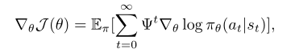

Trong đó $`\psi^{t}`$ thường chọn là hàm lợi thế $`A^{\pi}(s_{t},a_{t})`$. Bài báo tham khảo phương pháp actor-critic lợi thế bất đồng bộ (A3C) để định nghĩa hàm lợi thế như sau:

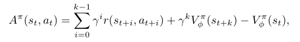

Trong đó $`V^{\pi}_{\phi}(s_{t})`$ là mạng giá trị, $`V^{\pi}_{t}(s_{t})=E_{\pi}[R_{t}]`$. $`\phi`$ là tham số của mạng giá trị, bài báo cập nhật TD để tối thiểu hóa bình phương chênh lệch giữa lợi tức tự cập nhật (bootstrap) $`k`$ bước $`\hat{R}_{t}`$ và giá trị dự đoán, $`\frac {1}{2}\left\|\hat{r}_{t} - V^{\pi}_{\phi}(s_{t})\right \|^{2}`$.

##### 1.2 Gradient tự nhiên dùng xấp xỉ nhân tử Kronecker

Để tối thiểu hóa hàm không lồi $`J(\theta)`$, dùng phương pháp giảm dốc nhất tính cập nhật $`\nabla \theta`$, tối thiểu hóa $`J(\theta + \nabla \theta)`$. Tuy nhiên sự thay đổi của chuẩn Euclid phụ thuộc vào tham số $`\theta`$, điều này không phù hợp; vì việc tham số hóa mô hình là một lựa chọn tùy ý, không nên ảnh hưởng đến quỹ đạo tối ưu. Phương pháp gradient tự nhiên dùng ma trận thông tin Fisher $`F`$ để xây dựng xấp xỉ bậc hai cục bộ của chuẩn - độ phân kỳ KL. Chuẩn này độc lập với tham số mô hình $`\theta`$ trên lớp phân phối xác suất, cung cấp cập nhật ổn định hơn, hiệu quả hơn. Nhưng vì mạng nơ-ron có thể chứa hàng triệu tham số, tính và lưu trữ chính xác ma trận Fisher và nghịch đảo của nó là không thực tế, vì vậy cần nhờ đến giá trị xấp xỉ. Kỹ thuật xấp xỉ độ cong nhân tử Kronecker dùng xấp xỉ nhân tử Kronecker của ma trận Fisher để thực hiện hiệu quả cập nhật gradient tự nhiên xấp xỉ. Chi tiết xem nguyên văn dưới đây:

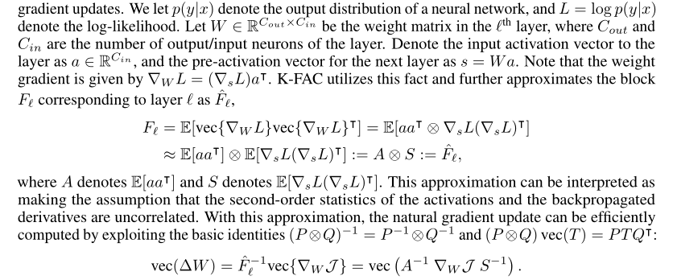

Xấp xỉ này có thể giải thích là giả định các thống kê bậc hai của kích hoạt và đạo hàm lan truyền ngược là không tương quan. Có xấp xỉ này, cập nhật gradient tự nhiên có thể tính hiệu quả. Cập nhật gradient tự nhiên xấp xỉ K-FAC chỉ cần tính trên các ma trận có kích thước tương đương $`W`$. Cũng có nghiên cứu mở rộng thuật toán K-FAC sang mạng tích chập và mạng phân tán, K-FAC phân tán tăng tốc độ 2-3 lần khi huấn luyện các mạng tích chập phân loại hiện đại cỡ lớn.

> Ghi chú của người dịch: bản gốc viết nhầm "Knonecker" ở nhiều chỗ, đúng là "Kronecker".

#### 2. Phương pháp

##### 2.1 Gradient tự nhiên trong actor-critic

Để định nghĩa thước đo Fisher của mục tiêu học tăng cường, bài báo dùng hàm chính sách, định nghĩa phân phối hành động khi cho trước trạng thái hiện tại, và lấy kỳ vọng trên phân phối quỹ đạo:

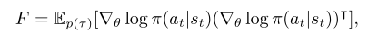

Bài báo mô tả một phương pháp áp dụng gradient tự nhiên để tối ưu critic. Học critic có thể xem là một bài toán xấp xỉ hàm bình phương tối thiểu, dù mục tiêu của bài toán này là di động. Trong xấp xỉ hàm bình phương tối thiểu thường dùng phương pháp Gauss-Newton. Nó xấp xỉ độ cong bằng ma trận Gauss-Newton $`G:=E[J^{T}J]`$, trong đó $`J`$ là ma trận Jacobian ánh xạ tham số đến đầu ra. Ma trận Gauss-Newton tương đương với ma trận Fisher của mô hình quan sát Gauss. Sự tương đương này cho phép ta áp dụng K-FAC cả cho critic. Giả sử ma trận Fisher của critic $`v`$ được định nghĩa theo phân phối Gauss $`p(v\mid s_{t})\sim N(v;V(s_{t},\sigma^{2}))`$. Ma trận Fisher của critic được định nghĩa theo phân phối đầu ra Gauss này. Đặt $`\sigma`$ bằng 1, đây chính là phương pháp Gauss-Newton thông thường.

Nếu actor và critic tách biệt, có thể dùng các thước đo định nghĩa ở trên để áp dụng cập nhật K-FAC riêng. Ta có thể định nghĩa phân phối đồng thời của phân phối chính sách và phân phối giá trị bằng cách giả định hai phân phối đầu ra độc lập, tức $`p(a,v\mid s)=\pi(a\mid s)p(v\mid s)`$, và xây dựng thước đo Fisher theo $`p(a,v\mid s)`$. Nó không khác K-FAC tiêu chuẩn, chỉ là ta cần lấy mẫu độc lập các đầu ra của mạng. Sau đó ta có thể áp dụng K-FAC để xấp xỉ ma trận Fisher $`E_{p(\tau)}[\nabla \log p(a,v|s)\nabla \log p(a,v|s)^{T}]`$, để cập nhật đồng thời.

Ngoài ra, tác giả còn dùng kỹ thuật chính quy hóa. Tác giả thực hiện tính bất đồng bộ các thống kê bậc hai và nghịch đảo cần cho xấp xỉ Kronecker, để giảm thời gian tính toán.

##### 2.2 Chọn bước và tối ưu vùng tin cậy

Dùng cập nhật gradient tự nhiên truyền thống sẽ khiến thuật toán hội tụ sớm về một chính sách gần như tất định. Bài báo dùng công thức vùng tin cậy của K-FAC, chọn bước hiệu dụng $`\eta`$ là 

```math
\min(\eta_{\max}, \sqrt{\frac{2\delta}{\nabla \theta^{T}\hat{F}\nabla \theta}})
```

Trong đó tốc độ học $`\eta`$ và bán kính vùng tin cậy $`\delta`$ là siêu tham số. Nếu actor và critic tách biệt, hai tham số này cần được chỉnh riêng.

#### 3. Các công trình liên quan

Gradient tự nhiên [1] lần đầu được Kakade [10] áp dụng vào phương pháp gradient chính sách. Bagnell và Schneider [3] chứng minh thêm rằng thước đo định nghĩa trong [10] là thước đo hiệp phương sai suy ra từ đa tạp phân phối đường đi. Peters và Schaal [19] sau đó áp dụng gradient tự nhiên vào thuật toán actor-critic. Họ đề xuất thực hiện gradient chính sách tự nhiên cho cập nhật actor, dùng phương pháp sai phân thời gian bình phương tối thiểu (LSTD) cho cập nhật critic.

Tuy nhiên, khi áp dụng phương pháp gradient tự nhiên, việc lưu trữ hiệu quả ma trận Fisher và tính nghịch đảo của nó có thách thức tính toán rất lớn. Các công trình trước giới hạn phương pháp này dùng bộ xấp xỉ hàm tương thích (bộ xấp xỉ hàm tuyến tính). Để tránh gánh nặng tính toán, tối ưu chính sách vùng tin cậy (TRPO) [21] giải xấp xỉ hệ tuyến tính, dùng gradient liên hợp và tích ma trận Fisher-vector nhanh, tương tự công trình của Martens [13]. Cách này có hai nhược điểm chính. Thứ nhất, nó cần tính lặp lại tích Fisher-vector, không thuận lợi để mở rộng sang các kiến trúc lớn hơn, tức các thực nghiệm học từ quan sát hình ảnh của Atari và MuJoCo. Thứ hai, nó cần lượng lớn quỹ đạo ngắn (rollout), để ước lượng chính xác độ cong.

K-FAC tránh hai vấn đề này bằng cách dùng xấp xỉ ma trận Fisher dễ xử lý và duy trì trung bình động của thống kê độ cong trong quá trình huấn luyện. Tuy TRPO cho thấy tiến bộ mỗi vòng lặp tốt hơn phương pháp gradient chính sách huấn luyện bằng bộ tối ưu bậc một như Adam [11], nhưng hiệu quả mẫu của nó thường khá thấp.

Một số phương pháp nâng cao hiệu quả tính toán của TRPO lần lượt được đề xuất. Để tránh tính lặp lại tích Fisher-vector, Wang và cộng sự [27] dùng xấp xỉ tuyến tính của độ phân kỳ KL giữa mạng chính sách và trung bình động của mạng chính sách hiện tại để giải bài toán tối ưu có ràng buộc. Heess và cộng sự [8] và Schulman và cộng sự [23] thêm chi phí KL vào hàm mục tiêu làm ràng buộc mềm, thay vì ràng buộc cứng do bộ tối ưu vùng tin cậy áp đặt. Về hiệu quả mẫu trên các nhiệm vụ điều khiển liên tục và rời rạc, cả hai bài báo đều cho thấy một số cải thiện so với gradient chính sách thông thường.

Gần đây còn đưa vào các mô hình actor-critic khác, nâng cao hiệu quả mẫu bằng cách đưa vào phát lại kinh nghiệm [27], [7] hoặc mục tiêu phụ trợ [9]. Các phương pháp này trực giao với công trình của bài báo, có thể kết hợp với ACKTR, để nâng cao thêm hiệu quả mẫu.

#### 4. Thực nghiệm

Bài báo thực hiện một loạt thực nghiệm để nghiên cứu các câu hỏi sau:

(1) Về hiệu quả mẫu và hiệu quả tính toán, ACKTR so với các phương pháp on-policy tiên tiến nhất và đường cơ sở bộ tối ưu bậc hai thông dụng thì thế nào?

(2) Chuẩn nào tốt hơn để tối ưu critic?

(3) So với phương pháp bậc một, hiệu năng của ACKTR khi co giãn theo batch size thế nào?

> Ghi chú của người dịch: ở câu (2) và tiêu đề mục 4.3, bản gốc dịch "critic" thành "临界" (tới hạn) và "norm" thành "范式" (mô thức); bản dịch đã sửa thành "critic" và "chuẩn (norm)".

Tác giả đánh giá phương pháp ACKTR được đề xuất trên hai nền tảng benchmark tiêu chuẩn. Tác giả dùng các môi trường nhiệm vụ trong Open AI Gym làm chuẩn đánh giá. Nhiệm vụ điều khiển rời rạc dùng bộ mô phỏng trò chơi Atari2600 làm chuẩn đánh giá; nhiệm vụ điều khiển liên tục dùng engine vật lý MuJoCo làm chuẩn đánh giá. Các thuật toán đường cơ sở để so sánh là A2C và TRPO. ACKTR và các thuật toán đường cơ sở dùng cùng kiến trúc mô hình, trừ đường cơ sở TRPO trên trò chơi Atari, do gánh nặng tính toán của vòng lặp trong gradient liên hợp, tác giả chỉ có thể dùng kiến trúc nhỏ hơn.

##### 4.1 Điều khiển rời rạc

Kết quả của 6 trò chơi Atari sau khi huấn luyện 10 triệu bước thời gian (1 bước thời gian bằng 4 khung hình) như hình 1, vùng tô bóng biểu thị độ lệch chuẩn của 2 hạt giống ngẫu nhiên. So với A2C và TRPO, trong tất cả các trò chơi, ACKTR vượt trội rõ rệt so với A2C về hiệu quả mẫu (tức tốc độ hội tụ theo số bước thời gian). Tác giả phát hiện TRPO chỉ học được hai trò chơi trong 10 triệu bước thời gian, tức *Seaquest* và *Pong*, và thể hiện không bằng A2C về hiệu quả mẫu.

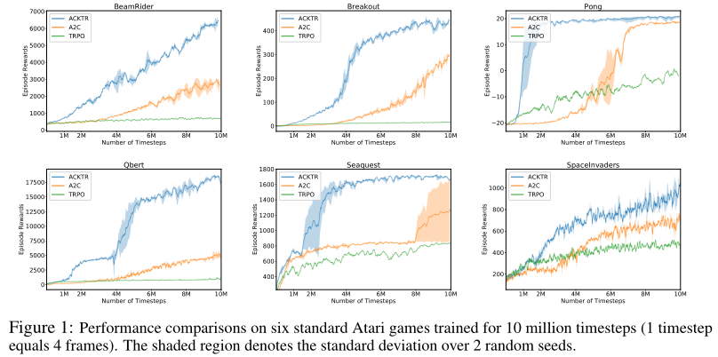

Bảng 1 là dữ liệu đánh giá thực nghiệm của nhiệm vụ điều khiển rời rạc trên sáu trò chơi Atari 2600. Kết quả ACKTR và A2C cho thấy phần thưởng trung bình của 100 lượt cuối có được sau 50 triệu bước thời gian, và kết quả TRPO có được sau 10 triệu bước thời gian. Bảng còn cho thấy lượt thứ $`N`$, trong đó $`N`$ là lượt đầu tiên mà phần thưởng trung bình của các trò chơi thứ $`N`$ đến thứ $`(N + 100)`$ vượt mức thể hiện của con người [16], trung bình trên 2 hạt giống ngẫu nhiên. Trong các trò chơi *Beamrider*, *Breakout*, *Pong* và *Q-bert*, A2C cần số lượt nhiều hơn ACKTR lần lượt 2.7, 3.5, 5.3 và 3.0 lần mới đạt được mức thể hiện của con người. Ngoài ra, trong *Space Invaders*, kết quả chạy của A2C không bằng con người, còn điểm trung bình của ACKTR là 19723, gấp 12 lần mức thể hiện của con người (1652). Trong *Breakout*, *Q-bert* và *Beamrider*, phần thưởng lượt mà ACKTR có được lần lượt cao hơn A2C 26%, 35% và 67%.

Tác giả còn đánh giá ACKTR trên các trò chơi Atari khác, kết quả đầy đủ xem phụ lục bài báo gốc. Tác giả so sánh ACKTR với các phương pháp Q-learning, phát hiện trong 36 trên 44 benchmark, ACKTR tương đương các phương pháp Q-learning về hiệu quả mẫu, và tiêu tốn thời gian tính toán ít hơn nhiều.

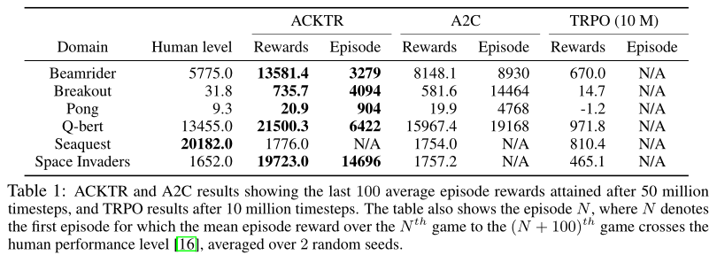

Như hình 2, trong trò chơi *Atlantis*, ACKTR rất nhanh học được cách đạt 2 triệu phần thưởng trong 1.3 giờ (600 lượt). A2C mất 10 giờ (6000 lượt) mới đạt cùng mức hiệu năng.

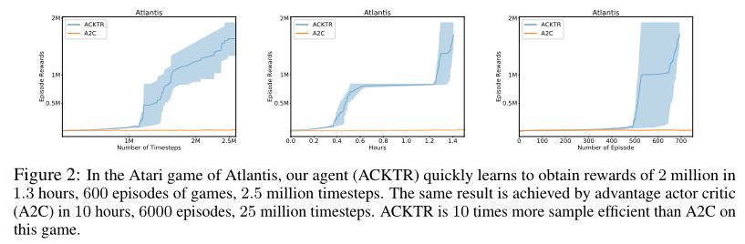

##### 4.2 Điều khiển liên tục

Tác giả mô phỏng nhiệm vụ điều khiển liên tục trong MuJoCo. Do không gian hành động nhiều chiều và khám phá, nhiệm vụ điều khiển liên tục đôi khi thách thức hơn. Kết quả của 8 môi trường MuJoCo sau khi huấn luyện 1 triệu bước thời gian như hình 3 (vùng tô bóng biểu thị độ lệch chuẩn của 3 hạt giống ngẫu nhiên). Mô hình của bài báo vượt trội rõ rệt so với đường cơ sở trên 6 trong 8 nhiệm vụ MuJoCo, trên hai nhiệm vụ còn lại (Walker2d và Swimmer) thì gần bằng A2C.

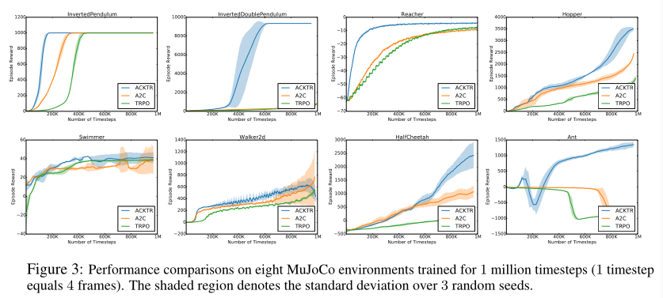

Như bảng 2, ACKTR đạt ngưỡng chỉ định nhanh hơn trên tất cả các nhiệm vụ, trừ Swimmer, hiệu quả mẫu của ACKTR gấp 4.1 lần TRPO. Một ví dụ đặc biệt đáng chú ý là Ant, trong đó hiệu quả mẫu của ACKTR gấp 16.4 lần TRPO. Về điểm phần thưởng trung bình, ngoài việc TRPO có điểm phần thưởng cao hơn 10% trong môi trường Walker2d, ba mô hình còn lại thể hiện tương đương.

> Ghi chú của người dịch: bản gốc viết "TRPO 的样本效率是 TRPO 的 4.1 倍" (hiệu quả mẫu của TRPO gấp 4.1 lần TRPO); theo ngữ cảnh và bài báo, đúng ra là hiệu quả mẫu **trung bình** của ACKTR gấp 4.1 lần TRPO.

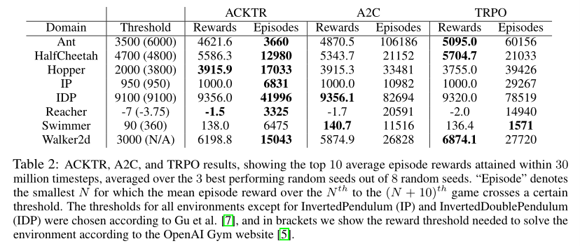

Tác giả còn thử học trực tiếp chính sách điều khiển liên tục từ điểm ảnh. Học chính sách điều khiển liên tục từ điểm ảnh thách thức hơn học từ không gian trạng thái, một phần vì thời gian render chậm hơn so với Atari (MuJoCo là 0.5 giây, Atari là 0.002 giây). Phương pháp actor-critic tiên tiến nhất A3C [17] chỉ báo cáo kết quả điểm ảnh cho các nhiệm vụ tương đối đơn giản, như Pendulum, Pointmass2D và Gripper. Như hình 4. Có thể thấy, sau khi huấn luyện 40 triệu bước thời gian, mô hình ACKTR vượt trội rõ rệt so với A2C về phần thưởng lượt cuối cùng. Cụ thể hơn, trên Reacher, HalfCheetah và Walker2d, phần thưởng cuối cùng mà mô hình của bài báo có được gấp 1.6 lần, 2.8 lần và 1.7 lần A2C.

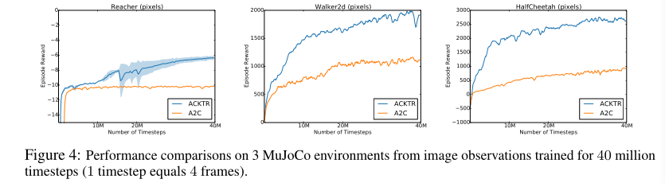

Video chính sách huấn luyện từ điểm ảnh: https: //www.youtube.com/watch?v=gtM87w1xGoM

Trọng số mô hình đã huấn luyện trước: https: //github.com/emansim/acktr.


#####  4.3 Có chuẩn nào tốt hơn để tối ưu critic không?

Các phương pháp gradient chính sách tự nhiên trước đây chỉ áp dụng cập nhật gradient tự nhiên cho actor, tác giả bài báo còn đề xuất áp dụng cập nhật gradient tự nhiên cho critic. Khác biệt chỉ nằm ở việc chọn chuẩn nào để thực hiện giảm gradient nhanh nhất cho critic; tức chuẩn $`\left \| \cdot \right \| _{B}`$ định nghĩa trong mục 2.2. Ở đây áp dụng ACKTR cho actor, và so sánh việc tối ưu critic bằng phương pháp bậc một (tức chuẩn Euclid) và bằng ACKTR (tức chuẩn định nghĩa bởi Gauss-Newton). Hình 5 (a) và (b) cho thấy kết quả của nhiệm vụ điều khiển liên tục *HalfCheetah* và trò chơi Atari *Breakout*. Tác giả quan sát thấy, bất kể dùng chuẩn nào để tối ưu critic, so với đường cơ sở A2C, áp dụng ACKTR cho actor đều mang lại cải thiện.

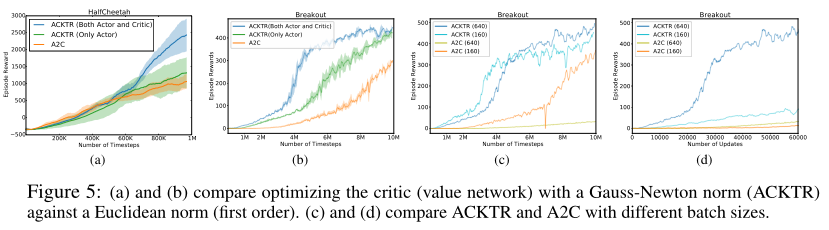

Tuy nhiên, cải thiện mang lại từ việc tối ưu critic bằng chuẩn Gauss-Newton rõ rệt hơn về hiệu quả mẫu và phần thưởng lượt khi kết thúc huấn luyện. Ngoài ra, chuẩn Gauss-Newton cũng giúp ổn định huấn luyện. Tác giả phát hiện thuật toán Gauss-Newton thích nghi không mang lại cải thiện đáng kể nào so với thuật toán Gauss-Newton thông thường.

##### 4.4 ACKTR so với A2C về thời gian thực (wall-clock time) thế nào?

Tác giả so sánh ACKTR với các đường cơ sở A2C và TRPO. Bảng 3 cho thấy số bước thời gian trung bình mỗi giây trong 6 trò chơi Atari và 8 môi trường MuJoCo (từ không gian trạng thái). Kết quả có được với cùng thiết lập thực nghiệm như trước. Chú ý rằng, trong MuJoCo, các lượt nhiệm vụ được xử lý tuần tự, còn trong môi trường Atari, các lượt được xử lý song song; vì vậy nhiều khung hình hơn được xử lý trong môi trường Atari. Từ bảng ta có thể thấy, ACKTR chỉ tăng tối đa 25% thời gian tính toán so với A2C, chứng minh tính thực dụng và lợi ích tối ưu rất lớn của nó.

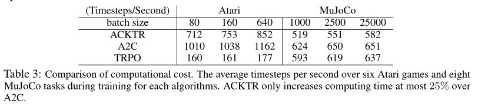

##### 4.5 ACKTR và A2C thể hiện thế nào với các kích thước batch khác nhau?

Tác giả so sánh thể hiện của ACKTR và đường cơ sở A2C với các batch size khác nhau. Chúng tôi lần lượt thử batch size 160 và 640. Hình 5 (c) cho thấy phần thưởng biểu diễn theo số bước thời gian.


Hình 5 (a) và (b) so sánh việc tối ưu critic (mạng giá trị) bằng chuẩn Gauss-Newton (ACKTR) và chuẩn Euclid (bậc một). (c) và (d) so sánh ACKTR và A2C với các batch size khác nhau.

Tác giả phát hiện, ACKTR với batch size lớn thể hiện tốt như ACKTR với batch size nhỏ. Nhưng, khi batch size tăng, hiệu quả mẫu của A2C giảm rõ rệt. Điều này tương ứng với kết quả quan sát trong hình 5 (d), trong hình 5 (d), chúng tôi vẽ đường cong huấn luyện theo số lần cập nhật. Chúng tôi phát hiện, so với dùng A2C, lợi ích của ACKTR với batch size lớn hơn tăng lên rất nhiều. Điều này cho thấy, trong thiết lập phân tán, ACKTR có tiềm năng tăng tốc rất lớn, trong trường hợp này cần dùng mini-batch lớn.

> Ghi chú của người dịch: bản gốc đánh số mục này là "5.5", đã sửa thành "4.5" cho đúng thứ tự.

#### 5. Kết luận

Bài báo đề xuất một phương pháp tối ưu vùng tin cậy hiệu quả mẫu cao và chi phí tính toán thấp cho học tăng cường sâu. Tác giả dùng một kỹ thuật gọi là K-FAC, xấp xỉ cập nhật gradient tự nhiên cho phương pháp actor-critic, và tối ưu vùng tin cậy để ổn định. Bài báo là công trình đầu tiên đề xuất dùng cập nhật gradient tự nhiên để tối ưu actor-critic. Tác giả kiểm tra phương pháp ACKTR trong trò chơi Atari và môi trường MuJoCo, quan sát thấy so với phương pháp gradient bậc một (A2C) và phương pháp bậc hai lặp (TRPO), hiệu quả mẫu trung bình tăng 2 đến 3 lần. Nhờ khả năng mở rộng của thuật toán, phương pháp này cũng là kỹ thuật đầu tiên huấn luyện điều khiển liên tục cho một số nhiệm vụ không tầm thường trực tiếp từ không gian quan sát điểm ảnh thô.

#### Tổng kết cá nhân
Bài báo nhắm đến vấn đề TRPO hiệu quả mẫu không cao, khó mở rộng, kết hợp kỹ thuật xấp xỉ nhân tử Kronecker của gradient chính sách tự nhiên, đề xuất kỹ thuật xấp xỉ nhân tử Kronecker có vùng tin cậy, dùng để tối ưu phương pháp actor-critic. Phương pháp của bài báo qua thực nghiệm điều khiển rời rạc và điều khiển liên tục cho thấy, nâng cao rõ rệt hiệu quả mẫu và khả năng mở rộng.

Wang Lijuan (汪莉娟): nghiên cứu sinh Đại học Thiên Tân, chuyên ngành khoa học và kỹ thuật điều khiển, hướng nghiên cứu chính là tối ưu giao thông và điều khiển thông minh.
