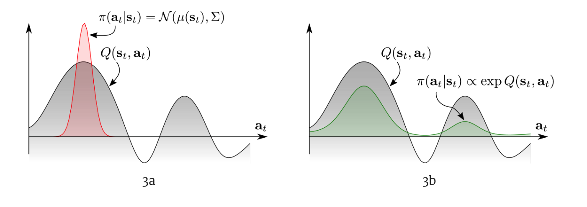
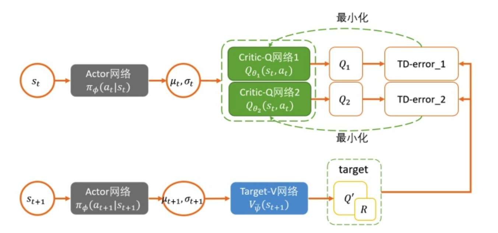
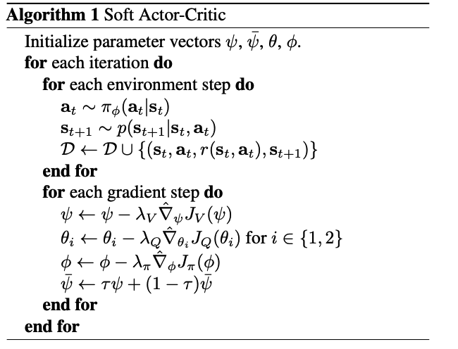
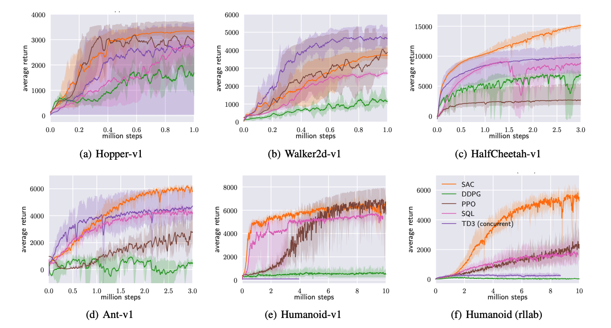

# Thuật toán SAC

Bài báo gốc: [Soft Actor-Critic: Off-Policy Maximum Entropy Deep Reinforcement Learning with a Stochastic Actor](https://arxiv.org/abs/1801.01290)

Thuật toán SAC là thuật toán off-policy. Các thuật toán off-policy trước đây có vấn đề độ phức tạp lấy mẫu cao và khó hội tụ, khiến chúng rất nhạy với siêu tham số. Thuật toán SAC vừa tối đa hóa return (lợi tức) kỳ vọng vừa tối đa hóa entropy, tức là cố gắng đạt lợi ích tích lũy cao nhất đồng thời giữ khám phá để tránh sớm rơi vào lời giải tối ưu cục bộ. SAC kết hợp khung actor-critic của các mô hình off-policy hiện có, giúp đạt hiệu quả SOTA trên các hạt giống ngẫu nhiên (random seed) khác nhau.

## Giới thiệu

Sự phát triển nhanh chóng của học tăng cường sâu đã mang lại nhiều tiến bộ cho lĩnh vực điều khiển robot. Trong các công trình trước, các thuật toán hướng đến nhiệm vụ điều khiển liên tục có TRPO, PPO, DDPG,...

PPO là một thuật toán on-policy hướng đến điều khiển rời rạc và liên tục, đạt hiệu quả khá tốt trên nhiều tập dữ liệu, nhưng có vấn đề hiệu quả lấy mẫu thấp nghiêm trọng, điều này khó chấp nhận đối với chi phí lấy mẫu của các bài toán điều khiển trong môi trường thực; DDPG là một thuật toán off-policy hướng đến bài toán điều khiển liên tục, hiệu quả lấy mẫu cao hơn PPO nhưng DDPG huấn luyện một chính sách tất định (deterministic policy), ở mỗi trạng thái chỉ chọn một hành động tối ưu, như vậy rất dễ rơi vào tình huống lời giải tối ưu cục bộ.

Trong bài toán điều khiển liên tục, thuật toán SAC kết hợp khung actor-critic hiện có, dùng chính sách ngẫu nhiên (stochastic policy) để tối đa hóa lợi ích tích lũy đồng thời giữ entropy lớn nhất, nâng cao hiệu quả lấy mẫu, tăng cường khả năng khám phá của tác tử, tránh tình huống sớm rơi vào lời giải tối ưu cục bộ, đồng thời cũng tăng cường khả năng tổng quát hóa và tính bền vững của mô hình trong các môi trường ban đầu khác nhau.

## Kiến thức chuẩn bị

### Học tăng cường entropy cực đại

Học tăng cường truyền thống tối đa hóa giá trị lợi tức tích lũy:
```math
J(\pi)=\sum_t\mathbb{E}_{(s_t,a_t)\sim\rho_\pi}[r(s_t,a_t)]
```
Còn hàm mục tiêu của thuật toán RL entropy cực đại là:
```math
J(\pi)=\sum^{T}_{t=0}\mathbb{E}_{(s_t,a_t)\sim\rho_\pi[r(s_t,a_t)+\alpha\mathcal{H}(\pi(\cdot|s_t))]}
```
Trong đó $`\alpha`$ là siêu tham số hệ số nhiệt độ của entropy, dùng để điều chỉnh mức độ coi trọng entropy. $`\mathcal{H}(\pi(\cdot|s_t))`$ là giá trị entropy, có thể biểu diễn là $`\mathcal{H}(\pi(\cdot|s_t))=-\mathbb{E}_{s_t}[\log \pi(\cdot|s_t)]`$.

Mục đích của việc thêm entropy vào lợi tức tích lũy là ngẫu nhiên hóa chính sách (stochastic), khi gặp một state có nhiều hành động tốt như nhau thì khuyến khích khám phá, có thể chọn ngẫu nhiên một trong các hành động này để tạo thành trajectory (quỹ đạo), chứ không phải luôn chọn cùng một chính sách tất định (deterministic) dẫn đến mô hình cuối cùng không thể học được lời giải tối ưu toàn cục.

## Soft policy Iteration (Lặp chính sách mềm)

Trong policy iteration (lặp chính sách) của học tăng cường model-free, thường chia quá trình cập nhật chính sách thành hai giai đoạn policy evaluation (đánh giá chính sách) và policy improvement (cải thiện chính sách).

### Soft policy evaluation (Đánh giá chính sách mềm)

Q function tiêu chuẩn:
```math
Q^\pi(s,a)=r(s,a)+\gamma\mathbb{E}_{(s^\prime,a^\prime)\sim\rho_\pi}[Q(s^\prime,a^\prime)]
```
V function tiêu chuẩn:
```math
V^\pi(s)=\mathbb{E}_{(s_t,a_t)\sim\rho_\pi}[Q(s^\prime,a^\prime)]
```
Đưa entropy vào phương trình tiêu chuẩn được Soft Value Function (hàm giá trị mềm):

Soft Q function:
```math
Q^\pi_{soft}(s,a)=r(s,a)+\gamma\mathbb{E}_{(s^\prime,a^\prime)\sim\rho_\pi}[Q(s^\prime,a^\prime)-\alpha\log(\pi(a^\prime|s^\prime))]
```
Soft V function:
```math
V^\pi_{soft}(s^\prime)=\mathbb{E}_{(s^\prime,a^\prime)\sim\rho_\pi}[Q_{soft}(s^\prime,a^\prime)-\alpha\log(\pi(a^\prime|s^\prime))]
```
Từ đó được phương trình Bellman của Soft Q và V:
```math
\begin{gathered}
Q^\pi_{soft}(s,a)&=&r(s,a)+\gamma\mathbb{E}_{(s^\prime,a^\prime)\sim\rho_\pi}[Q(s^\prime,a^\prime)-\alpha\log(\pi(a^\prime|s^\prime))]\\
&=&r(s,a)+\gamma\mathbb{E}_{s^\prime\sim\rho}[V^\pi_{soft}(s^\prime)]
\end{gathered}
```
Với policy cố định, dùng soft Bellman equation để cập nhật Q value cho đến khi hội tụ.

### Soft policy improvement (Cải thiện chính sách mềm)

Tầm quan trọng của stochastic policy: đối mặt với Q function đa mốt (multimodal), RL truyền thống chỉ có thể hội tụ về một lựa chọn (hình trái), còn cách tốt hơn là hình phải, để policy cũng trực tiếp phù hợp với phân phối của Q.



Để thích ứng với các nhiệm vụ phức tạp hơn, chính sách trong MERL (học tăng cường entropy cực đại) không còn có dạng phân phối Gauss như trước, mà dùng mô hình dựa trên năng lượng (energy-based model) để biểu diễn chính sách:
```math
\pi(a_t|s_t)\propto \exp(-\mathcal{E}(s_t,a_t))
```
Để liên kết EBP (chính sách dựa trên năng lượng) với hàm giá trị, đặt $`\mathcal{E}(s_t,a_t)=-\frac{1}{\alpha}Q_{soft}(s_t,a_t)`$, do đó $`\pi(a_t|s_t)\propto \exp(-\frac{1}{\alpha}Q_{soft}(s_t,a_t))`$

Biến đổi soft v function được:
```math
\begin{gathered}
\pi(s_t,a_t)&=&\exp(\frac{1}{\alpha}Q_{soft}(s_t,a_t)-V_{soft}(s_t))\\
&=&\frac{\exp(\frac{1}{\alpha}Q_{soft}(s_t,a_t)}{\exp(\frac{1}{\alpha}V_{soft}(s_t))}
\end{gathered}
```
Định nghĩa softmax (chú ý softmax ở đây khác với trong mạng nơ-ron, softmax trong mạng nơ-ron thực chất là soft argmax lấy giá trị lớn nhất của phân phối)
```math
softmax_af(a):=\log\int expf(a)da
```
Do đó $`V_{soft}(s_t)=\alpha softmax_a(\frac{1}{\alpha}Q_{soft}(s_t,a_t))`$,

Theo Soft Q function có thể chuyển về dạng softmax:
```math
Q_{soft}(s_t,a_t)=\mathbb{E}[r_t+\gamma softmax_aQ(s_{t+1},a_{t+1})]
```
Do đó toàn bộ quy trình Policy Iteration có thể tổng kết là:

**soft policy evaluation:** cố định policy, dùng phương trình Bellman cập nhật giá trị Q cho đến khi hội tụ
```math
Q^\pi_{soft}(s,a)=r(s,a)+\gamma\mathbb{E}_{(s^\prime,a^\prime)\sim\rho_\pi}[Q(s^\prime,a^\prime)-\alpha\log(\pi(a^\prime|s^\prime))]
```
**soft policy improvement:** cập nhật policy
```math
\pi^\prime=\arg\min_{\pi_k\in \prod}D_{KL}(\pi_k(\cdot|s_t)||\frac{\exp(\frac{1}{\alpha}Q^\pi_{soft}(s_t,\cdot))}{Z_{soft}^\pi(s_t)})
```


## Khung Soft Actor-Critic



Việc xây dựng thuật toán SAC trước tiên là mạng nơ-ron hóa, ta dùng mạng nơ-ron để biểu diễn Q và Policy: $`Q_\theta(s_t,a_t)`$ và $`\pi_\phi(a_t|s_t)`$. Mạng Q khá đơn giản, MLP vài tầng cuối cùng đưa ra một giá trị đơn biểu thị Q là được, mạng Policy cần đưa ra một phân phối, thường là đưa ra một Gaussian gồm mean (trung bình) và covariance (hiệp phương sai). Dưới đây là xây dựng công thức cập nhật của mạng nơ-ron.

### Critic

Xây dựng hai mạng Q, mỗi lần cập nhật dùng tham số của mạng có giá trị Q nhỏ hơn, hàm mất mát của mạng Q là:
```math
J_Q(\theta)=\mathbb{E}_{(s_t,a_t,s_{t+1})\sim \mathcal{D}}[\frac{1}{2}(Q_\theta(s_t,a_t)-(r(s_t,a_t)+\gamma V_{\bar{\theta}}(s_{t+1})))^2]
```
$`\bar{\theta}`$ là tham số của mạng target soft Q, thay biểu thức lặp của V vào:
```math
J_Q(\theta)=\mathbb{E}_{(s_t,a_t,s_{t+1})\sim \mathcal{D}}[\frac{1}{2}(Q_\theta(s_t,a_t)-(r(s_t,a_t)+\gamma (Q_{\bar \theta}(s_{t+1},a_{t+1})-\alpha\log(\pi(a_{t+1}|s_{t+1})))))^2]
```

### Actor

Hàm mất mát của mạng Policy là:
```math
\begin{gathered}
J_\pi(\phi)&=&D_{KL}(\pi_k(\cdot|s_t)||\frac{\exp(\frac{1}{\alpha}Q^\pi_{soft}(s_t,\cdot))}{Z_{soft}^\pi(s_t)})\\
&=&\mathbb{E}_{s_t\sim\mathcal{D},a\sim\pi_\phi}[\log\pi_\phi(a_t|s_t)-\frac{1}{\alpha}Q_\theta(s_t,a_t)+\log Z(s_t)]
\end{gathered}
```
Trong đó đầu ra của mạng chính sách là một phân phối hành động, tức trung bình và phương sai của phân phối Gauss, action ở đây được lấy bằng mẹo tham số hóa lại (reparameterization trick), tức là:
```math
a_t=f_\phi(\epsilon_t;s_t)=f^\mu_\phi(s_t)+\epsilon_t\cdot f^\mu_\phi(s_t)
```

> Ghi chú của người dịch: trong công thức tham số hóa lại ở trên, số hạng thứ hai đúng ra là độ lệch chuẩn $`f^\sigma_\phi(s_t)`$ (tức $`a_t=f^\mu_\phi(s_t)+\epsilon_t\cdot f^\sigma_\phi(s_t)`$); bản gốc viết $`f^\mu`$ hai lần, bản dịch giữ nguyên công thức và ghi chú tại đây.

### Update temperature (Cập nhật hệ số nhiệt độ)

Trong SAC ở trên, ta chỉ cho trước thủ công một temperature $`\alpha`$ cố định làm trọng số của entropy, nhưng thực tế vì reward liên tục thay đổi, dùng temperature cố định là không hợp lý, sẽ làm toàn bộ việc huấn luyện không ổn định, vì vậy cần có khả năng tự động điều chỉnh temperature này. Khi policy khám phá đến vùng mới, action tối ưu còn chưa rõ, nên tăng temperature để khám phá thêm nhiều không gian. Khi một vùng đã được khám phá gần đủ, action tối ưu về cơ bản đã xác định, thì temperature này có thể giảm.

Thông qua việc xây dựng một bài toán tối ưu có ràng buộc, để trọng số entropy có thể thay đổi ở các trạng thái khác nhau, được hàm mất mát của trọng số:
```math
J(\alpha)=\mathbb{E}_{a_t\sim\pi_t}[-\alpha \log \pi_t(a_t|\pi_t)-\alpha\mathcal{H}_0]
```
Thuật toán soft actor-critic biểu diễn bằng mã giả như sau:



## Thực nghiệm



Trên các benchmark điều khiển liên tục, hiệu quả tốt hơn đa số thuật toán SOTA (DDPG, PPO, SQL, TD3).

## Tổng kết

Ưu thế của thuật toán học tăng cường dựa trên entropy cực đại:

1) Policy học được có thể dùng làm khởi tạo cho các nhiệm vụ cụ thể phức tạp hơn. Vì thông qua entropy cực đại, policy không chỉ học một cách giải quyết nhiệm vụ, mà là tất cả (all). Do đó policy như vậy càng có lợi cho việc học nhiệm vụ mới. Ví dụ lúc đầu ta học đi, sau đó cần học đi theo một hướng cụ thể nào đó.

2) Khả năng exploration (khám phá) mạnh hơn, điều này hiển nhiên, có thể dễ dàng tìm được mốt tốt hơn dưới reward đa mốt (multimodal reward). Ví dụ vừa yêu cầu robot đi tốt, vừa yêu cầu robot tiết kiệm năng lượng.

3) Bền vững (robust) hơn, khả năng generalization (tổng quát hóa) mạnh hơn. Vì phải khám phá các khả năng tối ưu theo nhiều cách khác nhau, cũng vì vậy khi đối mặt với nhiễu loạn có thể dễ dàng điều chỉnh hơn. (Nhiễu loạn sẽ là một loại state mà mạng nơ-ron nhìn thấy trong quá trình học, đã khám phá được, học được thì có thể phản ứng tốt hơn, tiếp tục đạt reward cao).

Tuy thuật toán SAC dùng mô hình energy-based, nhưng thực tế phân phối chính sách vẫn là phân phối Gauss, có một số hạn chế nhất định.

====================================

Tác giả: Yang Junming (杨骏铭)

Đơn vị nghiên cứu: Đại học Bưu chính Viễn thông Nam Kinh

Hướng nghiên cứu: học tăng cường, học đối kháng

Email liên hệ: jmingyang@outlook.com
