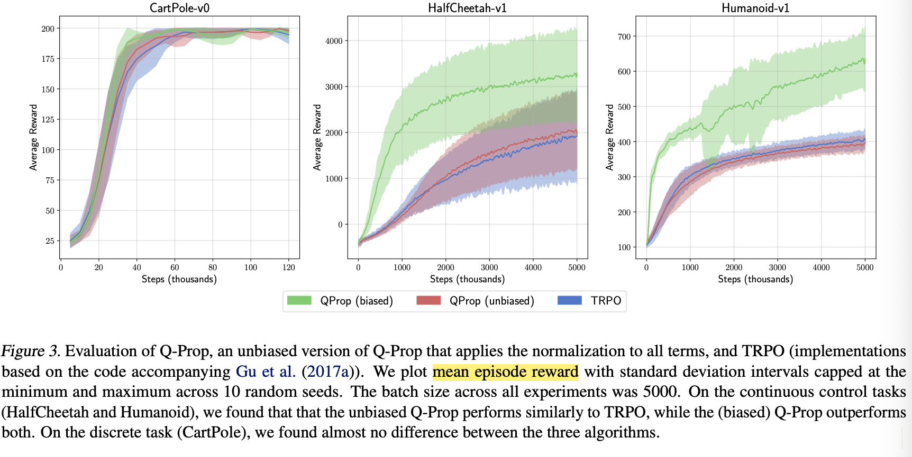
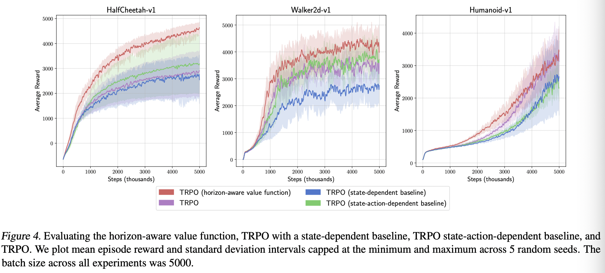

## The Mirage of Action-Dependent Baselines in Reinforcement Learning

Tác giả: George Tucker, Surya Bhupatiraju, Shixiang Gu, Richard E. Turner, Zoubin Ghahramani, Sergey Levine

Link bài báo: https://arxiv.org/abs/1802.10031v3

**Điểm nổi bật:** bài báo phê bình và đánh giá lại các bài báo trước đó, cho rằng các bài báo trước giảm được phương sai là nhờ một số mẹo khi cài đặt, chứ không thực sự không chệch; đồng thời đề xuất một hàm giá trị trạng thái có nhận biết tầm (horizon-aware)

### **Motivation (Why - Động cơ):**

Khi phân tách và nghiên cứu số học về phương sai của bộ ước lượng gradient chính sách, tác giả phát hiện các phương pháp giảm phương sai gradient chính sách trong các bài báo trước thực ra không giảm phương sai, đây là một phát hiện ngoài dự đoán. Vì vậy tác giả xem lại code mã nguồn mở của họ, phát hiện kết quả thực nghiệm của họ là nhờ một số mẹo khi cài đặt code. Thông qua phân tích phương sai, tác giả chỉ ra những chỗ có thể cải thiện, và nhờ một thay đổi nhỏ đã cải thiện đáng kể hiệu năng thuật toán.

### **Main Idea (What - Ý tưởng chính):**

#### **Phân tách phương sai**

Tác giả phân tách phương sai của gradient chính sách thành dạng sau
```math
\begin{aligned}
\Sigma=& \underbrace{\mathbb{E}_{s, a}\left[\mathrm{Var}_{\tau \mid s, a}(\hat{A}(s, a, \tau) \nabla \log \pi(a \mid s))\right]}_{\Sigma_\tau} \\
&+\underbrace{\mathbb{E}_s\left[\mathrm{Var}_{a \mid s}((\hat{A}(s, a)-\phi(s, a)) \nabla \log \pi(a \mid s))\right]}_{\Sigma_a} \\
&+\underbrace{\mathrm{Var}_s\left(\mathbb{E}_{a \mid s}[\hat{A}(s, a) \nabla \log \pi(a \mid s)]\right)}_{\Sigma_s}
\end{aligned}
```
Tác giả phân tích nguồn gốc phương sai trong gradient chính sách: đến từ việc ta chỉ thu thập được hữu hạn dữ liệu về trạng thái $`s`$, ở mỗi trạng thái cũng chỉ thực hiện một hành động $`a`$, rồi khi tính toán cũng chỉ dùng một mẫu $`\tau`$. Vì vậy rất trực quan, $`\sum_{\tau}, \sum_{a}, \sum_{s}`$ lần lượt mô tả phương sai đến từ ba hạn chế này. Trong đó, phương sai thứ hai $`\sum_a`$ là phương sai liên quan đến hàm đường cơ sở (baseline), cũng có thể ký hiệu là $`\sum_a^{\phi(s)}`$. Khi $`\phi(s)`$ là tối ưu, $`\sum_a`$ biến mất, chỉ còn lại hai số hạng $`\sum_{\tau} + \sum_{s}`$. Vì vậy khi $`\sum_a`$ rất lớn so với hai số hạng còn lại, việc chọn hàm đường cơ sở tối ưu có thể giảm hiệu quả phương sai, ví dụ trong môi trường Cliffworld, một lựa chọn hành động sai có thể khiến tác tử rơi xuống vách đá và nhận phần thưởng âm rất lớn, vì vậy giảm phương sai do hành động mang lại $`\sum_a`$ có thể cải thiện đáng kể hiệu năng thuật toán.

#### **Đo lường phương sai**

Qua việc tái hiện code của các công trình trước, tác giả phát hiện, nhiều phương pháp tuyên bố đã giảm phương sai của bộ ước lượng gradient thực ra không giảm phương sai, mà ngược lại đưa vào độ chệch về kỳ vọng, nhờ đó cải thiện hiệu quả thuật toán.



So sánh hiệu năng thuật toán trong quá trình huấn luyện của thuật toán QProp ước lượng không chệch, các thuật toán QProp và TRPO ước lượng có chệch.

### **Main Contribution (How - Đóng góp chính):**

Tác giả đề xuất hàm nhận biết tầm (horizon-aware), trên cơ sở hàm giá trị ban đầu thêm vào dự đoán giá trị tương lai $`\sum_{i=t}^T \gamma^{i-t} \hat{r}(s_t)`$.
```math
\hat{V}\left(s_t\right)=\left(\sum_{i=t}^T \gamma^{i-t}\right) \hat{r}\left(s_t\right)+\hat{V}^{\prime}\left(s_t\right)
```


Tác giả kết hợp thuật toán TRPO với hàm nhận biết tầm và các hàm đường cơ sở khác, so sánh hiệu quả trên các nhiệm vụ khác nhau.

#### Công việc chính

1. Đề xuất một phương pháp giảm phương sai gradient chính sách thông qua hàm giá trị chính xác hơn hoặc hàm đường cơ sở phụ thuộc trạng thái, đề xuất hàm giá trị nhận biết tầm có xét đến suy giảm phần thưởng.
2. Tác giả nghiên cứu chi tiết ảnh hưởng của hàm giá trị phụ thuộc trạng thái-hành động đối với phương sai, tái hiện code mã nguồn mở của các công trình trước. Phát hiện mức giảm phương sai mà các nghiên cứu trước đạt được là nhờ đưa vào độ chệch kỳ vọng khi cài đặt code, chứ không phải ước lượng thực sự không chệch
3. Kết hợp hàm giá trị nhận biết tầm do bài báo đề xuất, cùng với các hàm đường cơ sở thực sự không chệch của các bài báo trước, với thuật toán TRPO để thực nghiệm, phát hiện chỉ có việc đưa vào hàm đường cơ sở do bài báo xây dựng là cho hiệu năng tốt hơn TRPO một chút, các phương pháp khác đều thể hiện kém hơn thuật toán TRPO.

Tác giả cũng đề xuất hướng nghiên cứu tiếp theo, tức là nghiên cứu sự đánh đổi giữa kỳ vọng (độ chệch) và phương sai trong quá trình tính gradient

### Giới thiệu người viết

Wu Wenhao (吴文昊), đang học thạc sĩ tại Đại học Giao thông Tây An, liên hệ: wwhwwh05@qq.com
