## Trust Region Policy Optimization
## (Tối ưu chính sách vùng tin cậy)
Tác giả: John Schulman, Sergey Levine, Pieter Abbeel, Michael Jordan, Philipp Moritz

Đơn vị tác giả: University of California, Berkeley, Department of Electrical Engineering and Computer Sciences

Nguồn công bố: Proceedings of the 32nd International Conference on Machine Learning, PMLR 37:1889-1897

Thời gian công bố: 2015

Địa chỉ xem bài báo: https://proceedings.mlr.press/v37/schulman15.html

Đóng góp của bài báo: bài báo này, thông qua một số xấp xỉ đối với phương án đã được chứng minh lý thuyết, phát triển một phương pháp đảm bảo cải thiện đơn điệu cho việc tối ưu chính sách điều khiển, gọi là tối ưu chính sách vùng tin cậy (TRPO). Các xấp xỉ của phương pháp này lệch khỏi lý thuyết, nhưng tập trung vào việc đảm bảo cải thiện đơn điệu, gần như không cần chỉnh siêu tham số. Phương pháp này phù hợp để tối ưu các chính sách phi tuyến quy mô lớn như mạng nơ-ron. Thông qua thực nghiệm mô phỏng robot và trò chơi Atari, bài báo vừa chứng minh phương pháp này thể hiện rất bền vững trên nhiều loại nhiệm vụ, vừa cung cấp một phương án thống nhất khả dĩ cho việc huấn luyện bộ điều khiển robot kết hợp nhận thức và điều khiển trong tương lai. Phương pháp này giảm độ phức tạp mẫu, cung cấp nền tảng thuật toán cho các nhiệm vụ học chính sách phức tạp sau này. Nói đơn giản, phương pháp cải thiện đơn điệu của bài báo đã biến lý thuyết tối ưu gradient chính sách khó áp dụng thành thuật toán tối ưu gradient chính sách có thể áp dụng thực tế.

### Motivation (why - Động cơ):

Các thuật toán tối ưu dựa trên gradient có độ phức tạp mẫu tốt hơn các thuật toán tối ưu không dùng gradient, nhưng trong bài toán điều khiển liên tục, các phương pháp dựa trên gradient thể hiện không tốt bằng tìm kiếm ngẫu nhiên không dùng gradient. Trong các nhiệm vụ học có giám sát với lượng tham số lớn, tối ưu gradient liên tục rất thành công trong việc xấp xỉ hàm cần học. Nếu mở rộng tối ưu gradient liên tục sang học tăng cường, sẽ có thể học được các chính sách điều khiển phức tạp và mạnh mẽ hiệu quả hơn.

### Main Idea (what - Ý tưởng chính)

Bài báo trước tiên chứng minh việc tối thiểu hóa một hàm mất mát thay thế (surrogate) nào đó đảm bảo cải thiện chính sách với bước tiến không tầm thường, sau đó thực hiện một loạt xấp xỉ cho thuật toán đã chứng minh lý thuyết, được một thuật toán thực dụng, bài báo gọi là tối ưu chính sách vùng tin cậy. Bài báo mô tả hai biến thể của thuật toán: một là phương pháp đường đơn (single path) có thể áp dụng cho thiết lập không mô hình (model-free), cái còn lại là phương pháp vine (dây leo), phương pháp này yêu cầu hệ thống trở về trạng thái cụ thể, điều thường chỉ khả thi trong mô phỏng. Các thuật toán này có khả năng mở rộng, có thể tối ưu chính sách phi tuyến với hàng chục nghìn tham số. Đây trước đây là thách thức chính của tìm kiếm chính sách không mô hình.

### How (Cách làm)

#### 1. Tiền đề

Định nghĩa một quá trình quyết định Markov (MDP) chiết khấu với tầm nhìn vô hạn là một bộ $`\langle S,A,P,c,\rho_{0},\gamma\rangle`$, $`S`$ là tập trạng thái hữu hạn, $`A`$ là tập hành động hữu hạn, $`P:S\times A\times S \to R`$ là phân phối xác suất chuyển, $`c:S\to R`$ là hàm chi phí, $`\rho_{0}:S\to R`$ là phân phối của trạng thái ban đầu $`s_{0}`$, $`\gamma \in(0,1)`$ là hệ số chiết khấu.

Gọi $`\pi`$ là chính sách ngẫu nhiên $`\pi:S\times A \to [0,1]`$, gọi $`\eta(\pi)`$ là chi phí chiết khấu kỳ vọng, thì có:

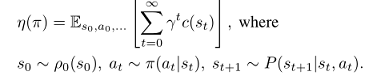

Định nghĩa chuẩn của hàm giá trị trạng thái-hành động $`Q_{\pi}`$, hàm giá trị $`V_{\pi}`$, hàm lợi thế $`A_{\pi}`$ như sau:

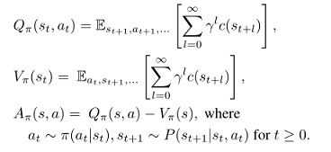

Khi đó theo sự tích lũy qua các bước thời gian, chi phí kỳ vọng của một chính sách khác $`\tilde{\pi}`$ được biểu diễn theo lợi thế của $`\pi`$ như công thức (1):

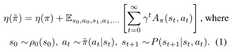

Gọi $`\rho_{\pi}`$ là tần suất thăm chiết khấu chưa chuẩn hóa, thì

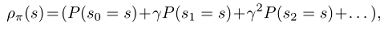

Sắp xếp lại công thức (1) thành tổng theo trạng thái, có công thức (2):

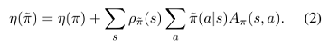

Công thức này có nghĩa là với bất kỳ cập nhật chính sách $`\pi \to \tilde{\pi}`$ nào mà $`\tilde{\pi}`$ có lợi thế kỳ vọng không dương tại mọi trạng thái $`s`$, tức $`\sum_{a}\tilde{\pi}(a|s)A(\pi)(s,a)\le 0`$, đều đảm bảo giảm $`\eta`$, hoặc giữ nguyên trong trường hợp lợi thế kỳ vọng bằng $`0`$ ở mọi nơi. Điều này hàm ý kết quả kinh điển của việc cập nhật bằng lặp chính sách chính xác. Tuy nhiên, trong thiết lập xấp xỉ, do sai số ước lượng và xấp xỉ, việc một số trạng thái có lợi thế kỳ vọng dương thường là không tránh khỏi, tức $`\sum_{a}\tilde{\pi}(a|s)A(\pi)(s,a)\ge 0`$. 
Sự phụ thuộc phức tạp của $`\rho_{\tilde{\pi}}`$ vào $`\tilde{\pi}`$ khiến công thức (2) khó tối ưu trực tiếp. Vì vậy bài báo đưa vào xấp xỉ cục bộ sau của $`\eta`$:

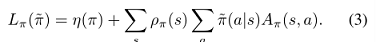

Tuy nhiên, nếu ta có một chính sách tham số hóa $`\pi_{\theta}`$, trong đó $`\pi_{\theta}(a|s)`$ là hàm khả vi của vector tham số $`\theta`$, thì $`L_{\pi}`$ khớp với $`\eta`$ đến bậc một. Tức là, với mọi giá trị tham số $`\theta_{0}`$, có

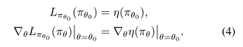

Công thức (4) cho thấy một bước cập nhật đủ nhỏ $`\pi_{\theta_{0}}\to \tilde{\pi}`$ mà cải thiện được $`L_{\pi_{old}}`$ thì cũng cải thiện được $`\eta`$, nhưng ta không biết bước này lớn bao nhiêu. Để giải quyết vấn đề này, Kakade & Langford (2002) đề xuất một phương án cập nhật chính sách gọi là lặp chính sách bảo thủ (conservative policy iteration), cung cấp cận dưới rõ ràng cho mức cải thiện của $`\eta`$.

Để định nghĩa cập nhật lặp chính sách bảo thủ, gọi $`\pi_{old}`$ là chính sách hiện tại, giả sử giải được $`\pi'=\arg\min_{\pi'}L_{\pi_{old}}(\pi')`$. Chính sách mới $`\pi_{new}`$ được lấy là chính sách hỗn hợp, như công thức (5):

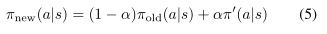

Kakade và Langford chứng minh kết quả sau của cập nhật này:

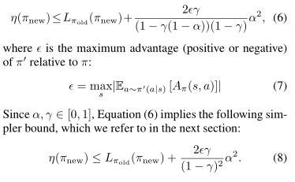

$`\epsilon`$ là lợi thế lớn nhất (âm hoặc dương) của $`\pi'`$ so với $`\pi`$, đẳng thức (6) đưa ra một cận đơn giản hơn. Cận này hơi yếu khi $`\alpha \ll 1`$. Cận này chỉ áp dụng cho chính sách hỗn hợp sinh ra bởi đẳng thức (5). Chính sách hỗn hợp không phù hợp với tình huống thực tế, với mọi chính sách ngẫu nhiên tổng quát cần một phương án cập nhật chính sách thực dụng.

#### 2. Đảm bảo cải thiện đơn điệu cho chính sách ngẫu nhiên tổng quát

Công thức (6) có nghĩa là cải thiện vế phải sẽ đảm bảo cải thiện mục tiêu chi phí kỳ vọng thực $`\eta`$. Kết quả lý thuyết chính của bài báo là, bằng cách thay $`\alpha`$ bằng một thước đo khoảng cách giữa $`\pi`$ và $`\tilde{\pi}`$, cận cải thiện chính sách trong công thức (6) có thể mở rộng cho chính sách ngẫu nhiên tổng quát, chứ không chỉ phù hợp với chính sách hỗn hợp. Kết quả này rất quan trọng để mở rộng đảm bảo cải thiện sang các bài toán thực tế. Với các phân phối xác suất rời rạc $`p,q`$, định nghĩa độ phân kỳ biến phân toàn phần (total variation divergence) giữa hai chính sách là:

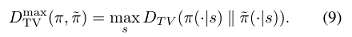

Định lý 1. Gọi $`\alpha=D^{\max}_{TV}(\pi_{old},\pi_{new})`$, gọi $`\epsilon=\max_{s}\left |  E_{a\sim\pi'(a|s)}[A_{\pi}(s,a)]\right |`$, thì công thức (8) đúng. Chứng minh ở phụ lục.

Ta chú ý rằng độ phân kỳ biến phân và độ phân kỳ KL có quan hệ như sau: $`D_{TV}(p||q)^2 \le D_{KL}(p||q)`$. Gọi $`D^{\max}_{KL}(\pi, \tilde{\pi}) = \max_{s}D_{KL}(\pi(\cdot|s))`$, có thể suy trực tiếp cận sau từ công thức (8), tức công thức (10):

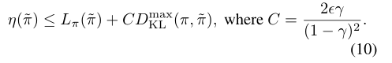

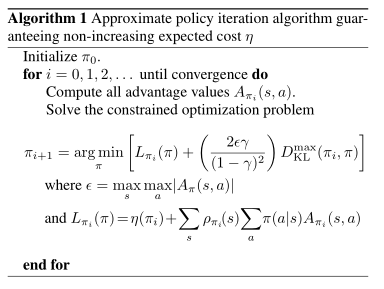

Thuật toán 1 mô tả phương pháp lặp chính sách xấp xỉ dựa trên cận cải thiện chính sách trong công thức (10). Chú ý rằng, ta giả định đánh giá chính xác giá trị lợi thế $`A_{\pi}`$.

Từ công thức (10) có thể biết, thuật toán 1 đảm bảo sinh ra một chuỗi chính sách cải thiện đơn điệu $`\eta(\pi_{0})\ge\eta(\pi_{1})\eta(\pi_{2})\ge ...`$. Gọi

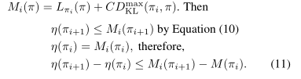

Bằng cách tối thiểu hóa $`M_{i}`$ trong mỗi vòng lặp, ta có thể đảm bảo mục tiêu thực $`\eta`$ không tăng. Thuật toán này là một thuật toán majorization-minimization (MM), đây là một lớp phương pháp bao gồm cả cực đại hóa kỳ vọng (EM). Trong thuật toán MM, $`M_{i}`$ là hàm thay thế (surrogate), bằng $`\eta`$ tại $`\pi_{i}`$. Thuật toán này cũng gợi nhớ đến phương pháp gradient cận kề (proximal gradient) và phương pháp giảm gương (mirror descent). Tối ưu chính sách vùng tin cậy đề xuất trong phần tiếp theo là xấp xỉ của thuật toán 1, nó dùng ràng buộc trên độ phân kỳ KL thay vì phạt để cho phép các bước cập nhật lớn một cách bền vững.

> Ghi chú của người dịch: chuỗi bất đẳng thức ở trên bản gốc thiếu một dấu $`\ge`$, đúng ra là $`\eta(\pi_{0})\ge\eta(\pi_{1})\ge\eta(\pi_{2})\ge ...`$.

#### 3. Tối ưu chính sách tham số hóa
Phần này trình bày cách từ cơ sở lý thuyết đưa ra một thuật toán ứng dụng, trên cơ sở số mẫu hữu hạn và tham số hóa bất kỳ.
Vì ta xét chính sách tham số hóa $`\pi_{\theta}(a|s)`$ với vector tham số $`\theta`$, nên ta dùng hàm theo $`\theta`$ thay vì $`\pi`$ để nạp chồng các ký hiệu chính sách trước đó. Mục tiêu tối ưu là công thức sau:

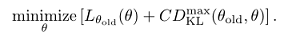

Nếu dùng hệ số phạt $`C`$ trong công thức trên, bước sẽ rất nhỏ, một cách để thực hiện các bước lớn hơn một cách bền vững là dùng ràng buộc trên độ phân kỳ KL giữa chính sách cũ và mới, tức ràng buộc vùng tin cậy, như công thức (12):

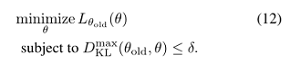

Công thức (12) áp đặt điều kiện ràng buộc, tức độ phân kỳ KL bị chặn tại mọi điểm trong không gian trạng thái. Bài báo dùng một xấp xỉ heuristic xét độ phân kỳ KL trung bình:

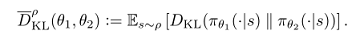

Từ đó bài toán tối ưu sinh ra cập nhật chính sách trở thành công thức (13):

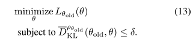

Các cập nhật chính sách tương tự đã được đề xuất trong các công trình trước, thực nghiệm của bài báo cũng so sánh với các phương pháp trước đó. Thực nghiệm cho thấy, loại cập nhật có ràng buộc này có hiệu năng thực nghiệm tương tự ràng buộc độ phân kỳ KL lớn nhất trong công thức (12).

#### 4. Ước lượng mục tiêu và ràng buộc dựa trên lấy mẫu

Phần này mô tả cách dùng mô phỏng Monte Carlo để xấp xỉ hàm mục tiêu và hàm ràng buộc. Khai triển $`L_{\theta_{old}}`$ trong công thức (13) được công thức (14):

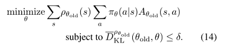

Dùng kỳ vọng $`\frac{1}{1-\gamma}E_{s\sim\rho_{old}}[...]`$ thay cho $`\sum_{s}\rho_{\theta_{old}}[...]`$, dùng giá trị lợi thế $`A_{\theta_{old}}`$ thay cho giá trị Q $`Q_{\theta_{old}}`$. Cuối cùng dùng một bộ ước lượng importance sampling thay cho tổng theo hành động, dùng $`q`$ biểu thị phân phối lấy mẫu, thì đóng góp của một $`s_{n}`$ vào hàm mất mát là:

Khi đó bài toán tối ưu trong công thức (14) hoàn toàn tương đương với bài toán tối ưu biểu diễn bằng kỳ vọng trong công thức (15):

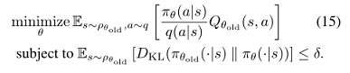

Phần còn lại là dùng trung bình mẫu thay cho kỳ vọng, dùng ước lượng thực nghiệm thay cho giá trị Q.

> Ghi chú của người dịch: bản gốc viết `frac{1}{1-\gamma}` (thiếu dấu `\`), bản dịch đã sửa thành `\frac`. Hai chỗ trên dùng cùng một hình `img/TRPO-14.png` như trong bản gốc.

Để thực hiện ước lượng này, bài báo đưa ra hai phương pháp khác nhau:

* Cách thứ nhất gọi là phương pháp lấy mẫu đường đơn (single path), thường dùng cho ước lượng gradient chính sách, nó dựa trên việc lấy mẫu các quỹ đạo riêng lẻ.
  
* Cách thứ hai gọi là phương pháp vine, nó xây dựng một tập triển khai (rollout), sau đó thực hiện nhiều hành động từ mỗi trạng thái trong tập triển khai. Phương pháp này chủ yếu dùng cho phương pháp lặp chính sách.

##### 4.1 Phương pháp đường đơn

Thu thập chuỗi trạng thái bằng cách lấy mẫu $`s_{0}\sim \rho_{0}`$, sau đó mô phỏng chính sách $`\pi_{\theta_{old}}`$ một số bước thời gian để sinh ra quỹ đạo $`s_{0},a_{0},s_{1},a_{1},...,s_{T-1},a_{T-1},s_{T}`$. Tức có $`q(a|s)=\pi_{\theta_{old}}(a|s)`$. Tại mỗi $`(s_{t},a_{t})`$ lấy tổng chiết khấu chi phí tương lai dọc theo quỹ đạo để tính $`Q_{\theta_{old}}(s,a)`$.

##### 4.2 Phương pháp vine

Lấy mẫu $`s_{0}\sim \rho_{0}`$, mô phỏng chính sách $`\pi_{\theta_{old}}`$ sinh ra nhiều quỹ đạo, chọn dọc theo quỹ đạo một tập con có $`N`$ trạng thái $`s_{1},s_{2},...,s_{N}`$, bài báo gọi là "rollout set" (tập triển khai). Trong tập này, với mỗi trạng thái $`s_{n}`$, lấy mẫu $`K`$ hành động theo $`a_{n,k}\sim q(\cdot|s_{n})`$. Bài báo phát hiện $`q(\cdot|s_{n})=\pi_{\theta_{i}}(\cdot|s_{n})`$ thể hiện rất tốt trên các bài toán liên tục huấn luyện chuyển động robot, còn phân phối đều có thể khám phá tốt hơn trên các nhiệm vụ rời rạc như trò chơi Atari.

Với mỗi hành động $`a_{n,k}`$ được lấy mẫu tại mỗi trạng thái $`s_{n}`$, ta ước lượng $`\hat{Q}_{\theta_{i}}(s_{n},a_{n,k})`$ bằng cách thực hiện một rollout (tức một quỹ đạo ngắn) bắt đầu từ trạng thái $`s_{n}`$ và hành động $`a_{n,k}`$. Ta có thể dùng cùng một chuỗi số ngẫu nhiên (tức số ngẫu nhiên chung) để xử lý nhiễu trong $`K`$ quỹ đạo ngắn, giảm đáng kể phương sai của chênh lệch giá trị $`Q`$ giữa các quỹ đạo ngắn.

Trong không gian hành động hữu hạn nhỏ, ta có thể sinh một quỹ đạo ngắn (rollout) cho mỗi hành động khả dĩ từ trạng thái đã cho. Đóng góp của một trạng thái $`s_{n}`$ vào $`L_{\theta_{old}}`$ như sau:

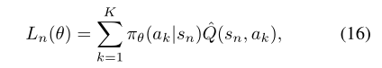

Trong không gian trạng thái lớn hoặc liên tục, ta dùng importance sampling để xây dựng bộ ước lượng của hàm mất mát thay thế. Bộ ước lượng tự chuẩn hóa của một trạng thái $`s_{n}`$ là

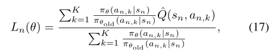

Giả sử ta thực hiện $`K`$ hành động $`a_{n,1}, a_{n,2}, …, a_{n,K}`$ từ trạng thái $`s_{n}`$. Bộ ước lượng tự chuẩn hóa này loại bỏ nhu cầu dùng đường cơ sở cho giá trị $`Q`$ (thêm một hằng số vào giá trị Q, gradient không đổi). Lấy trung bình theo $`s_{N}\sim \rho(\pi)`$, có thể được bộ ước lượng của $`L_{\theta_{old}}`$, cùng gradient của nó.

Hình 1 minh họa phương pháp vine và phương pháp đường đơn.

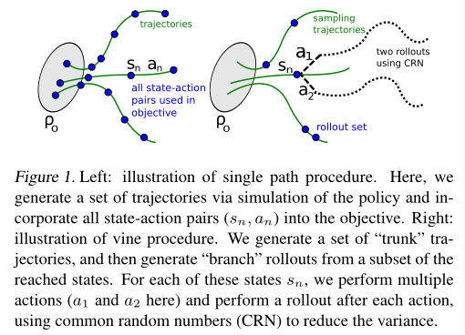

Hình trái là sơ đồ quy trình đường đơn. Sinh một tập quỹ đạo bằng cách mô phỏng chính sách, và gộp tất cả các cặp trạng thái-hành động $`(s_{n}, a_{n})`$ vào mục tiêu. Hình phải là sơ đồ phương pháp vine. Sinh một tập quỹ đạo "thân chính", sau đó sinh các triển khai "nhánh" từ một tập con các trạng thái đạt được. Với mỗi trạng thái $`s_{n}`$, thực hiện nhiều hành động (ở đây là $`a_{1}`$ và $`a_{2}`$), và sau mỗi hành động thực hiện một quỹ đạo ngắn, dùng số ngẫu nhiên chung (CRN) để giảm phương sai.

Quỹ đạo dùng để lấy mẫu trong phương pháp vine có thể ví như thân của dây leo, nó chia thành vài nhánh ngắn (quỹ đạo triển khai) ở các điểm khác nhau (tập quỹ đạo ngắn).

Với cùng số mẫu giá trị $`Q`$ cho hàm mất mát thay thế, phương pháp vine tốt hơn phương pháp đường đơn, ước lượng cục bộ của mục tiêu có phương sai thấp hơn. Tức phương pháp vine cho ước lượng giá trị lợi thế tốt hơn. Nhược điểm của phương pháp vine là với các ước lượng lợi thế này, phải gọi bộ mô phỏng nhiều lần hơn. Ngoài ra, phương pháp vine yêu cầu ta sinh nhiều quỹ đạo từ mỗi trạng thái trong tập triển khai, điều này giới hạn thiết lập của thuật toán vào những hệ thống có thể đặt lại về trạng thái bất kỳ. Ngược lại, thuật toán đường đơn không cần đặt lại trạng thái, có thể cài đặt trực tiếp trên hệ thống vật lý.

> Ghi chú của người dịch: ở mục 4.2, bản gốc viết $`q(\cdot|s_{n}=\pi_{\theta_{i}}(\cdot|s_{n})`$ (thiếu dấu ngoặc đóng), bản dịch đã sửa thành $`q(\cdot|s_{n})=\pi_{\theta_{i}}(\cdot|s_{n})`$.

#### 5. Thuật toán thực dụng

Dựa trên phương pháp lấy mẫu đường đơn và vine, bài báo đề xuất hai thuật toán tối ưu chính sách thực dụng. Thuật toán lặp lại các bước sau:

1. Dùng quy trình đường đơn hoặc vine để thu thập một tập cặp trạng thái-hành động, cùng ước lượng Monte Carlo của giá trị $`Q`$ tương ứng.
   
2. Bằng cách lấy trung bình trên nhiều mẫu, xây dựng mục tiêu ước lượng và điều kiện ràng buộc trong công thức (15).
   
3. Giải xấp xỉ bài toán tối ưu có ràng buộc này, cập nhật vector tham số $`\theta`$ của chính sách. Bài báo dùng thuật toán gradient liên hợp, kèm tìm kiếm theo đường (line search).
   

Ở bước 3, bài báo tính giải tích ma trận Hessian của độ phân kỳ KL bằng cách xây dựng ma trận thông tin Fisher (FIM), không dùng ma trận hiệp phương sai của gradient. Bộ ước lượng giải tích lấy tích phân theo hành động tại mỗi trạng thái $`s_{n}`$, không phụ thuộc vào hành động được lấy mẫu $`a_{t}`$.

Tổng kết mối liên hệ giữa tối ưu chính sách tham số hóa ở phần 3 và thuật toán của bài báo như sau:

* Lý thuyết chứng minh có thể tối ưu hàm mất mát thay thế bằng cách phạt độ phân kỳ KL. Tuy nhiên hệ số phạt lớn $`\frac{2\epsilon \gamma}{({2-\gamma})^{2}}`$ sẽ dẫn đến bước rất nhỏ, thuật toán của bài báo muốn giảm hệ số này. Bài báo dùng ràng buộc cứng với tham số $`\delta`$ (cận của độ phân kỳ KL) thay cho phạt.
  
* Ràng buộc $`D^{\max}_{KL}(\theta_{old},\theta)`$ rất khó tối ưu và ước lượng bằng số, nên thuật toán của bài báo ràng buộc $`D_{KL}(\theta_{old},\theta)`$.
  
* Lý thuyết thuật toán của bài báo bỏ qua sai số ước lượng của hàm lợi thế để đơn giản hóa, nhưng suy luận của Kakade & Langford (2002) có xét sai số này.
  
#### 6. Liên hệ với các công trình trước

Thuật toán cập nhật chính sách được suy ra trong bài báo liên quan đến một số phương pháp trước đây.

Gradient chính sách tự nhiên: là trường hợp đặc biệt của cập nhật công thức (13), bằng cách xấp xỉ tuyến tính $`L`$, dùng xấp xỉ bậc hai cho ràng buộc $`\bar{D}_{KL}`$, được công thức sau:

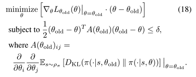

Cập nhật $`\theta _{new}=\theta _{old}-\lambda A(\theta _{old})^{-1} \nabla _{\theta }L(\theta )|_{\theta =\theta _{old}}`$, trong đó nhân tử Lagrange $`\lambda`$ là tham số thuật toán. Cập nhật của thuật toán này khác với TRPO của bài báo, TRPO bắt buộc thực thi ràng buộc ở mỗi lần cập nhật. Thực nghiệm chứng minh, thuật toán của bài báo nâng cao hiệu năng khi xử lý các bài toán lớn hơn.

Bằng cách dùng ràng buộc hoặc phạt $`l_{2}`$, TRPO cũng thu được cập nhật gradient chính sách tiêu chuẩn:

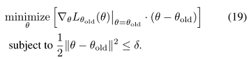

Bằng cách giải bài toán không ràng buộc $`minimize_{\pi}L_{\pi_{old}}(\pi)`$ cũng có thể được cập nhật lặp chính sách.

Tìm kiếm chính sách entropy tương đối (REPS) ràng buộc biên trạng thái-hành động $`p{s,a}`$, còn TRPO ràng buộc điều kiện $`p(s,a)`$, không cần tối ưu phi tuyến trong vòng lặp trong.

Levine and Abbeel (2014) dùng ràng buộc độ phân kỳ KL, TRPO không ước lượng tường minh động lực học của hệ thống. 

#### 7. Thực nghiệm

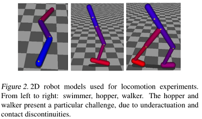

Hình 2 là mô hình robot 2D trong thực nghiệm chuyển động: swimmer, hopper, walker. Do thiếu cơ cấu chấp hành (underactuated) và tiếp xúc liên tục, hopper và walker khá khó huấn luyện.

Thực nghiệm trả lời một số câu hỏi:

(1) Đặc điểm hiệu năng của lấy mẫu đường đơn và vine là gì?

(2) TRPO dùng độ phân kỳ KL cố định ảnh hưởng thế nào đến hiệu năng thuật toán?

(3) TRPO có thể dùng để giải các bài toán quy mô lớn có tính thách thức không? Khi dùng cho bài toán quy mô lớn, về hiệu năng cuối cùng, thời gian tính toán và độ phức tạp mẫu, TRPO so với các phương pháp khác thế nào?

Kết quả thực nghiệm cho thấy, cả thuật toán đường đơn và vine đều có thể huấn luyện từ đầu các bộ điều khiển chuyển động chất lượng cao, khi chơi trò chơi Atari hiệu năng của các thuật toán này cũng rất tốt.

##### 7.1 Mô phỏng chuyển động cơ học

Thực nghiệm: thực nghiệm di chuyển robot mujoco (ba robot mô phỏng, như hình 2)

Trạng thái: vị trí và vận tốc tổng quát của robot

Điều khiển: mô-men khớp

Thách thức: thiếu cơ cấu chấp hành, số chiều cao, lực ma sát do tiếp xúc

Mô hình đánh giá: Swimmer, Hopper, Walker, thêm một cart-pole cổ điển

Kết quả đánh giá thuật toán trên các mô hình xem hình 4. Hình 3 phía trên là mạng huấn luyện chuyển động robot, phía dưới là mạng chơi trò chơi Atari. Bài báo dùng mạng nơ-ron để biểu diễn chính sách, tham số xem phụ lục bài báo.

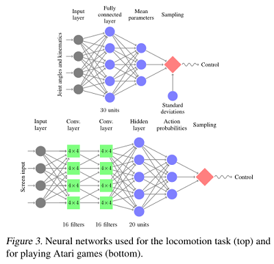

Hình 4 là đường cong học của huấn luyện robot, kết quả trung bình của năm lần chạy khởi tạo ngẫu nhiên của mỗi thuật toán, tốc độ tiến về phía trước của hopper và walker là -1, cho thấy chỉ học được đứng thăng bằng, chưa học được cách đi.

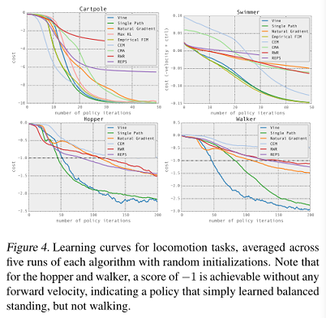

Các phương pháp so sánh: TRPO đường đơn, TRPO vine, hồi quy có trọng số phần thưởng (RWR), phương pháp tìm kiếm chính sách kiểu EM, tìm kiếm chính sách entropy tương đối (REPS), phương pháp entropy chéo (CEM), phương pháp không gradient, thích nghi ma trận hiệp phương sai (CMA), thuật toán gradient chính sách tự nhiên cổ điển (dùng hệ số phạt cố định - nhân tử Lagrange), FIM thực nghiệm (dùng ma trận hiệp phương sai của gradient), max KL (chỉ áp dụng cho cart-pole, dùng độ phân kỳ KL lớn nhất).

Đường cong học cho thấy chi phí trung bình của năm lần chạy của mỗi thuật toán, như hình 4. TRPO đường đơn và vine giải được tất cả các bài toán, có được lời giải tốt nhất. Gradient tự nhiên thể hiện tốt trên hai bài toán đơn giản hơn, nhưng không thể tạo ra dáng nhảy và đi tiến về phía trước. Các kết quả này cung cấp bằng chứng thực nghiệm: so với dùng phạt cố định, ràng buộc độ phân kỳ KL là cách bền vững hơn để chọn bước và đạt tiến bộ nhanh, nhất quán. CEM và CMA là các thuật toán không dùng đạo hàm, vì vậy độ phức tạp mẫu của chúng tỉ lệ nghịch với số tham số, thể hiện không tốt trên các bài toán lớn hơn. Tốc độ học của phương pháp KL lớn nhất chậm hơn một chút so với phương pháp cuối cùng của chúng tôi, vì dạng ràng buộc chặt hơn, nhưng nhìn chung, kết quả cho thấy ràng buộc độ phân kỳ KL trung bình có hiệu quả tương tự độ phân kỳ KL lớn nhất được chứng minh lý thuyết.

> Ghi chú của người dịch: theo bài báo gốc, CEM và CMA là phương pháp không dùng đạo hàm nên độ phức tạp mẫu của chúng tăng kém theo số tham số (scale unfavorably), tức là cần nhiều mẫu hơn khi số tham số tăng; cụm "tỉ lệ nghịch" trong bản gốc nên hiểu theo nghĩa này.

Link video chính sách học được bởi TRPO: http://sites.google.com/ site/trpopaper/.

##### 7.2 Chơi trò chơi từ hình ảnh

Đầu vào: hình ảnh gốc của trò chơi Atari

Thách thức học: học nhiều hành vi khác nhau, phần thưởng trễ, chuỗi hành vi phức tạp, nền thay đổi nhấp nháy

Cách làm: tiền xử lý hình ảnh giống DQN, hai tầng tích chập có 16 kênh, stride là 2, một tầng kết nối đầy đủ có 20 đơn vị, 33500 tham số.

Kết quả của phương pháp đường đơn và phương pháp vine như bảng 1, còn bao gồm một người chơi và Deep Q-Learning, tổ hợp tìm kiếm cây Monte Carlo với huấn luyện có giám sát.

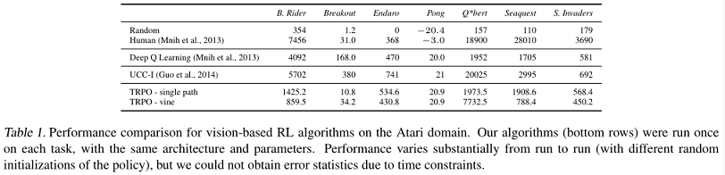

Thuật toán TRPO (hàng dưới cùng) chạy một lần trên mỗi nhiệm vụ, dùng cùng kiến trúc và tham số. Hiệu năng giữa các lần chạy khác nhau có chênh lệch rất lớn (khởi tạo ngẫu nhiên chính sách khác nhau), nhưng do giới hạn thời gian, tác giả không thể có được số liệu thống kê sai số.

> Ghi chú của người dịch: bản gốc viết "和DAN一样对图像预处理" (giống DAN), đã sửa thành DQN.

#### 8. Thảo luận và kết luận

Bài báo đề xuất và phân tích phương pháp vùng tin cậy cho tối ưu chính sách điều khiển ngẫu nhiên. Bài báo chứng minh tính cải thiện đơn điệu của TRPO, thuật toán này lặp lại việc tối ưu một xấp xỉ cục bộ của chi phí kỳ vọng của chính sách, với phạt độ phân kỳ KL. Bài báo cho thấy, trên một loạt nhiệm vụ học chính sách có tính thách thức, xấp xỉ của phương pháp kết hợp độ phân kỳ KL này đạt kết quả thực nghiệm tốt, vượt các phương pháp trước đây. Phân tích của bài báo cũng cung cấp một góc nhìn thống nhất giữa phương pháp gradient chính sách và lặp chính sách, cho thấy chúng là các trường hợp giới hạn đặc biệt của một thuật toán, thuật toán này có thể tối ưu một mục tiêu tuân theo ràng buộc vùng tin cậy.

Trong lĩnh vực chuyển động robot, thuật toán của bài báo dùng mạng nơ-ron và chi phí thông tin tối thiểu trong bộ mô phỏng vật lý Mujoco, học thành công điều khiển bơi, đi và nhảy. Trong các công trình trước đây chưa có bộ điều khiển nào học từ đầu các nhiệm vụ này bằng phương pháp tìm kiếm chính sách tổng quát và biểu diễn chính sách tổng quát không qua thiết kế thủ công.

Trong lĩnh vực trò chơi, thuật toán dùng mạng nơ-ron tích chập CNN, lấy hình ảnh gốc làm đầu vào. Điều này cần tối ưu chính sách có số chiều cực cao. Trước đây chỉ có hai phương pháp thành công trong nhiệm vụ này.

#### Triển vọng tương lai của tác giả

Phương pháp của bài báo có khả năng mở rộng và có nền tảng lý thuyết vững chắc, tác giả hy vọng lấy đây làm điểm xuất phát, tương lai có thể huấn luyện các bộ xấp xỉ hàm lớn và phong phú, để giải một loạt bài toán có tính thách thức. Kết hợp giao thoa giữa hai lĩnh vực thực nghiệm đã khám phá, có thể dùng thị giác và dữ liệu cảm biến thô làm đầu vào, có khả năng học chính sách điều khiển robot, cung cấp một phương án thống nhất cho việc huấn luyện bộ điều khiển robot kết hợp nhận thức và điều khiển. Có thể dùng chính sách phức tạp hơn, bao gồm chính sách hồi quy có trạng thái ẩn, có thể tiếp tục đưa ước lượng trạng thái và điều khiển vào cùng một chính sách trong thiết lập quan sát được một phần. Bằng cách kết hợp phương pháp của bài báo với học mô hình, cũng có khả năng giảm đáng kể độ phức tạp mẫu, giúp nó áp dụng được cho môi trường thực tế nơi mẫu quý giá.

#### Hiểu biết cá nhân

Khi dùng hàm giá trị để giải bài toán không gian trạng thái liên tục, chính sách chọn hành động thường là chính sách tất định không đổi. Một số bài toán thực tế cần chính sách tối ưu không phải tất định, mà là chính sách ngẫu nhiên, gradient chính sách chính là để giải bài toán sinh chính sách ngẫu nhiên. Phương pháp gradient chính sách Monte Carlo cổ điển dựa trên lấy mẫu, cho trước chính sách $`\pi`$, để tác tử tương tác với môi trường, sẽ được nhiều quỹ đạo, mỗi quỹ đạo có lợi tức tương ứng. Lấy trung bình lợi tức của các quỹ đạo, là biết được giá trị của trạng thái dưới một chính sách. Trong thuật toán PG, vì chính sách là một xác suất, không thể dùng trực tiếp để lặp, nên chuyển chính sách thành dạng hàm. Dùng hàm có tham số $`\theta`$ để xấp xỉ chính sách, tiến gần chính sách tối ưu bằng cách cập nhật $`\theta`$. Nội dung nghiên cứu của tôi không phải bản thân thuật toán RL, chỉ xem xét ứng dụng thuật toán gradient chính sách, chưa làm dự án liên quan, nên hiểu biết về bài báo này còn nông, rất mong được giao lưu thảo luận.

Wang Lijuan (汪莉娟): nghiên cứu sinh Đại học Thiên Tân, chuyên ngành khoa học và kỹ thuật điều khiển, hướng nghiên cứu chính là tối ưu giao thông và điều khiển thông minh.
